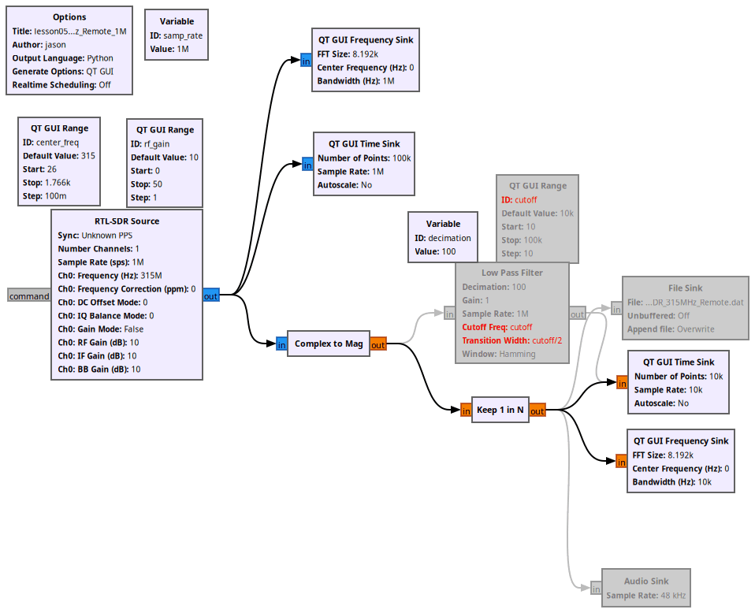

# Lesson 5 --- On-Off Keying with Adafruit Keyfob 4-Button RF Remote Control

<iframe width="560" height="315" src="https://www.youtube.com/embed/b6tmHRZhBKQ" title="YouTube video player" frameborder="0" allow="accelerometer; autoplay; clipboard-write; encrypted-media; gyroscope; picture-in-picture" allowfullscreen></iframe>

<b> A Short Review of the Video </b>

1. Name the program, set the samp_rate to 1 MHz, and insert the RTL-SDR Source, Time Sink, and Frequency Sink.
2. Set the center frequency of the RTL-SDR Source to 315 MHz (marked as 'Ch0: Frequency (Hz)').
3. Connect the RTL-SDR Source block to both Sinks.
4. Press run, and then experiment using the Adafruit Keyfob.

<b> Working with the Adafruit Keyfob </b>
Perform the following experiments with the keyfob:
1. Try finding the pattern of each separate button A, B, C, and D in the time sink. How do each of them change? Is the signal of one of the buttons shorter than the signal of another? How are they different?
2. Similarly, look at the frequencies. Hold the keyfob close to the antenna for this. Look at how many peaks their are on the frequency graph. Which buttons have more than one peak in dB of frequency? Why does this happen when the keyfob is held close to the antenna?
3. Put in a constellation sink. Move the keyfob closer to and then away from the antenna while pressing a button. Do you notice anything interesting about the constellation pattern? Does the constellation change with different buttons pushed?

<!-- flowgraphs:begin -->
## Flowgraphs

[`lesson05b_RTL_SDR_315MHz_Remote_1M.grc`](https://github.com/gallicchio/learnSDR/blob/main/lesson05b_RTL_SDR_315MHz_Remote_1M.grc)

{:target="_blank"}

Other flowgraphs for this lesson:

- [`lesson05b_RTL_SDR_315MHz_Remote_1M_4plots_end_of_video.grc`](https://github.com/gallicchio/learnSDR/blob/main/lesson05b_RTL_SDR_315MHz_Remote_1M_4plots_end_of_video.grc)
- [`lesson05b_RTL_SDR_315MHz_Remote_Audio.grc`](https://github.com/gallicchio/learnSDR/blob/main/lesson05b_RTL_SDR_315MHz_Remote_Audio.grc)
<!-- flowgraphs:end -->

All GNURadio flowgraphs are at [https://github.com/gallicchio/learnSDR](https://github.com/gallicchio/learnSDR)

