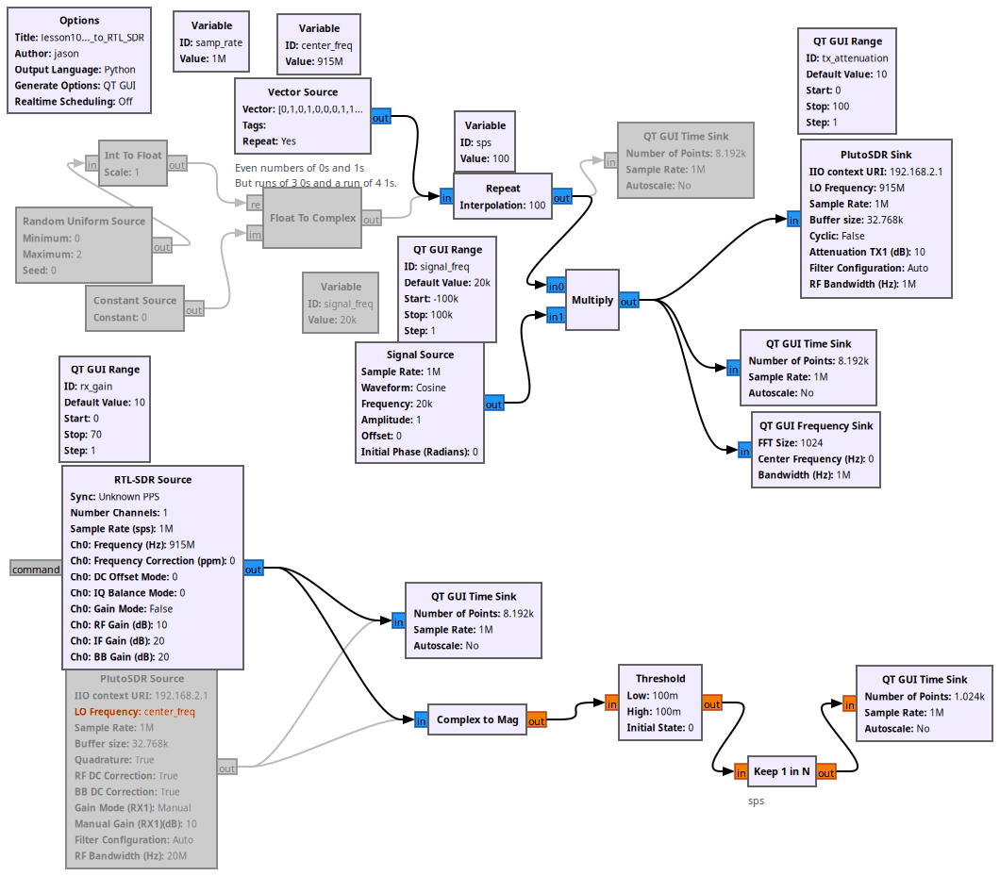
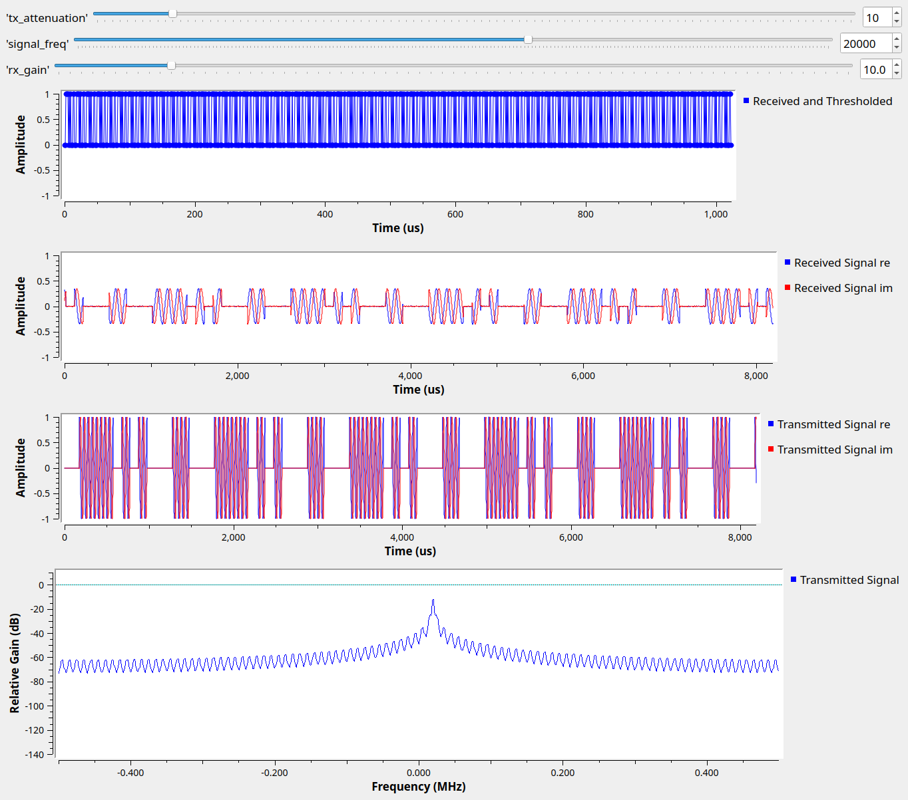

# Lesson 10 --- On-Off Keying (OOK) from Pluto to RTL SDR

<iframe width="560" height="315" src="https://www.youtube.com/embed/bzR7VfjtZyo" title="YouTube video player" frameborder="0" allow="accelerometer; autoplay; clipboard-write; encrypted-media; gyroscope; picture-in-picture" allowfullscreen></iframe>

<!-- flowgraphs:begin -->
## Flowgraphs

[`lesson10_OOK_Pluto_to_RTL_SDR.grc`](https://github.com/gallicchio/learnSDR/blob/main/lesson10_OOK_Pluto_to_RTL_SDR.grc)

{:target="_blank"}

Running:

{:target="_blank"}
<!-- flowgraphs:end -->

All GNURadio flowgraphs are at [https://github.com/gallicchio/learnSDR](https://github.com/gallicchio/learnSDR)

 
