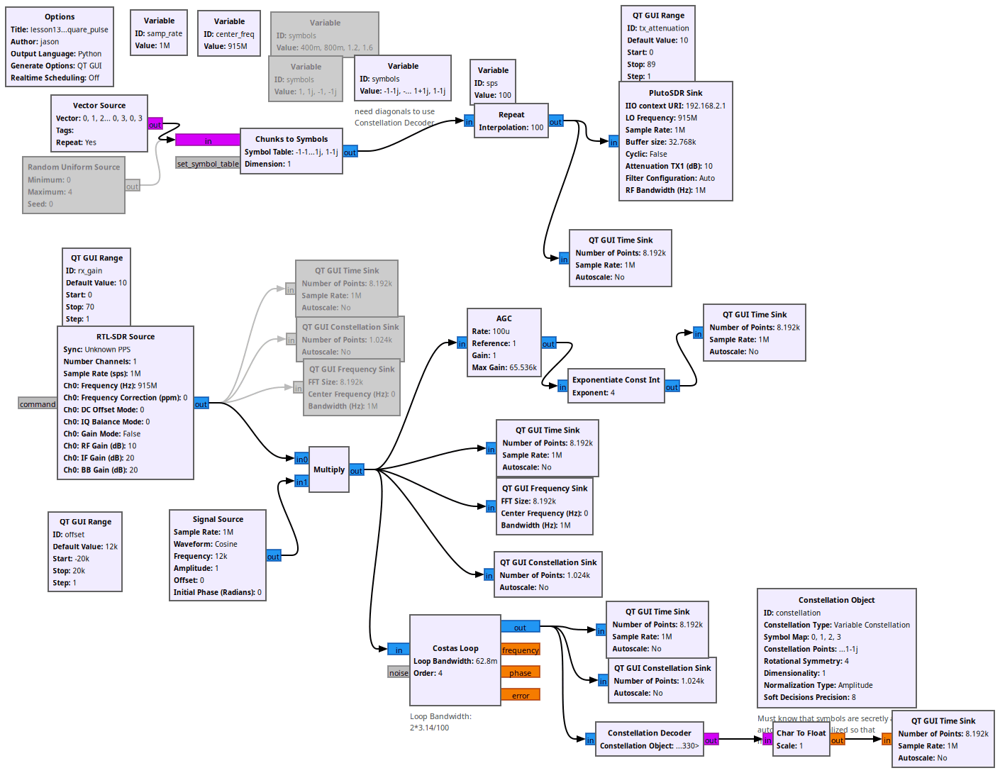
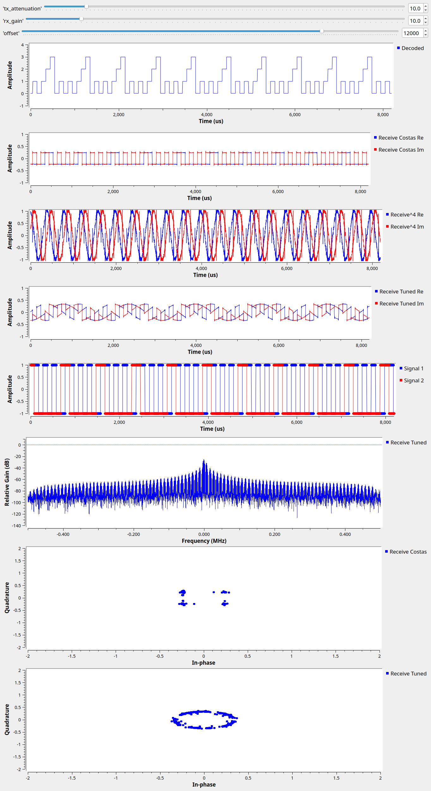

# Lesson 13 --- Quadrature Phase Shift Keying (QPSK)

<iframe width="560" height="315" src="https://www.youtube.com/embed/4jWEMJdNZqE" title="YouTube video player" frameborder="0" allow="accelerometer; autoplay; clipboard-write; encrypted-media; gyroscope; picture-in-picture" allowfullscreen></iframe>

Last time, we used 1 to represent binary 1, and -1 to represent binary 0 (although some people reverse these roles) in BPSK.

Coding is the one's bit is at negative -1/sqrt(2) and two's bit is at positive 1/sqrt(2) or
(-1-1j, -1+1j, 1-1j, 1+1j)

ordering is Gray coding

<!-- flowgraphs:begin -->
## Flowgraphs

[`lesson13_QPSK_square_pulse.grc`](https://github.com/gallicchio/learnSDR/blob/main/lesson13_QPSK_square_pulse.grc)

{:target="_blank"}

Running:

{:target="_blank"}

Other flowgraphs for this lesson:

- [`lesson13_old_modulation_sim.grc`](https://github.com/gallicchio/learnSDR/blob/main/lesson13_old_modulation_sim.grc)
<!-- flowgraphs:end -->

All GNURadio flowgraphs are at [https://github.com/gallicchio/learnSDR](https://github.com/gallicchio/learnSDR)

