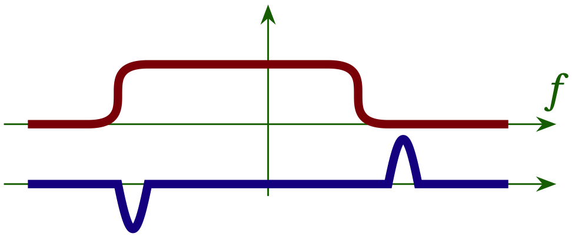
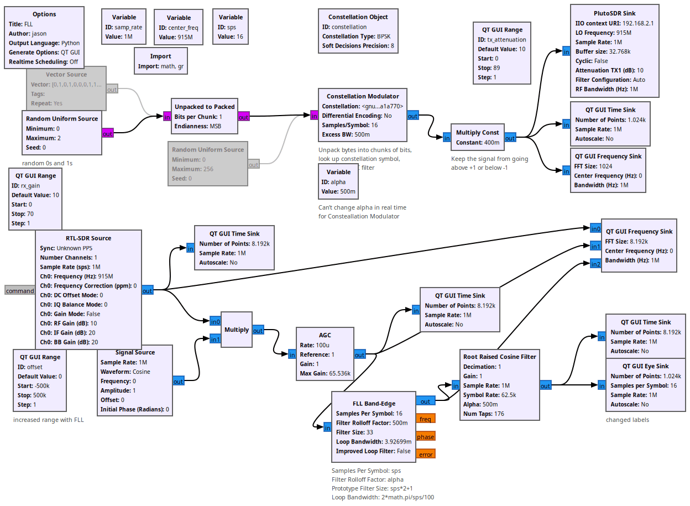
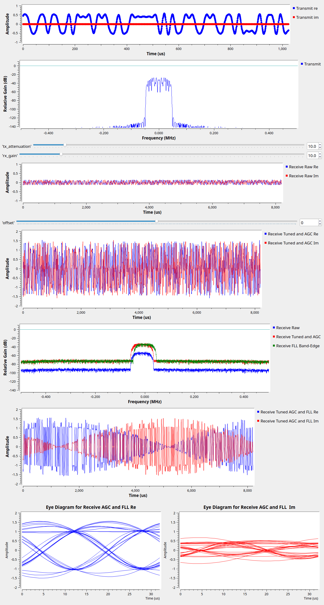

# Lesson 17 --- Frequency Locked Loop (FLL)

<iframe width="560" height="315" src="https://www.youtube.com/embed/jJHnJtcKW0M" title="YouTube video player" frameborder="0" allow="accelerometer; autoplay; clipboard-write; encrypted-media; gyroscope; picture-in-picture" allowfullscreen></iframe>

The first step in automating signal recovery is to correct for the difference in clock rate between the transmitter and receiver. The key insight here is to look at the range of frequencies at the receiver and adjust it to be centered around zero.

To do this, we use a band-edge filter with a positive peak centered on where the correct spectrum is falling off on the positive side and a negative peak where the spectrum falls off on the negative side

**Figure 1** --- The received spectrum in red is not centered around zero frequency. If we multiply by the blue filter and sum, we will get a large negative contribution from the left bump and essentially nothing from the right bump, since the received spectrum effectively vanishes there. The sum is thus negative, telling us that the red curve has been shifted to lower frequency compared to the desired symmetric arrangement.

## Properties of the FLL Band-Edge block
- samples per symbol: `sps`
- filter rolloff factor: `alpha` (must match the transmitter's root-raised-cosine `alpha`)
- prototype filter size: `sps*2+1`
- loop bandwidth: `2 * math.pi / sps / 100`

The loop bandwidth is in radians per *sample*. The FLL runs at the full sample rate (`sps` = 16 samples per symbol), so `2*math.pi/sps/100` means the loop averages over roughly 100 *symbols*. (An earlier version of this flowgraph used `/1000`, which locks ten times more slowly; the `/100` here is the same value used in Lessons 18--20.)

## Questions

1. What happens if you change the FLL loop bandwidth by a factor of two? By a factor of ten?
2. The FLL can only pull in an offset that is smaller than about half the symbol rate (here 62.5 kHz / 2). What happens if you use the `offset` slider to push the signal farther away than that?

<!-- flowgraphs:begin -->
## Flowgraphs

[`lesson17_FLL.grc`](https://github.com/gallicchio/learnSDR/blob/main/lesson17_FLL.grc)

{:target="_blank"}

Running: the FLL has centered the received spectrum:

{:target="_blank"}
<!-- flowgraphs:end -->

All GNURadio flowgraphs are at [https://github.com/gallicchio/learnSDR](https://github.com/gallicchio/learnSDR)

