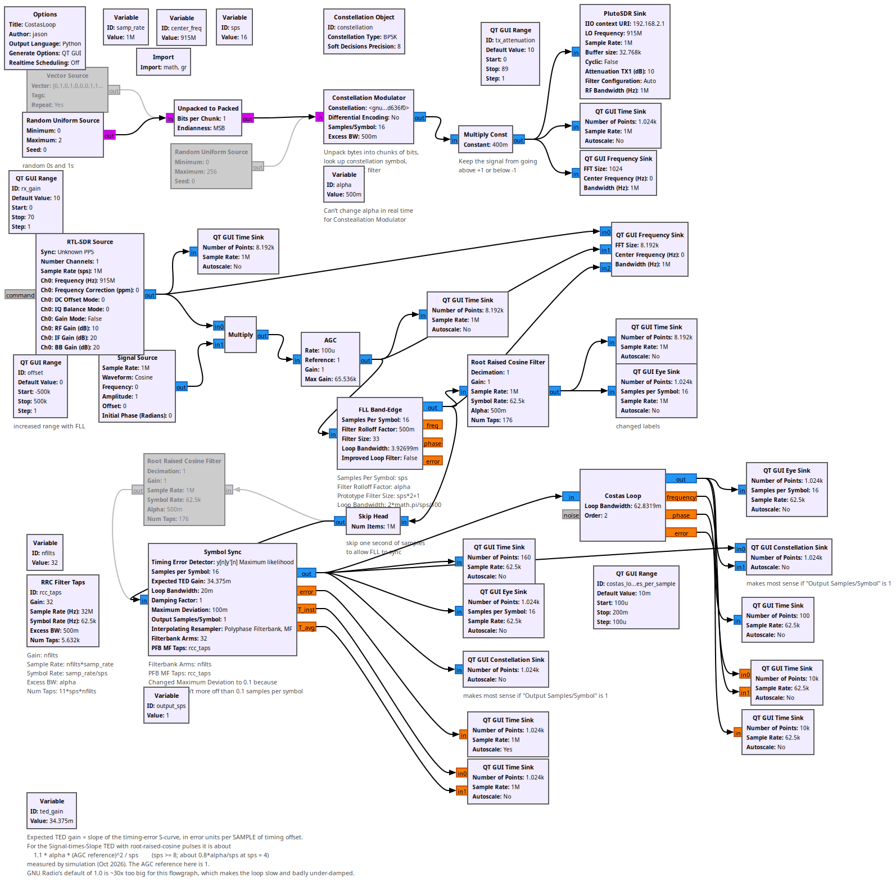
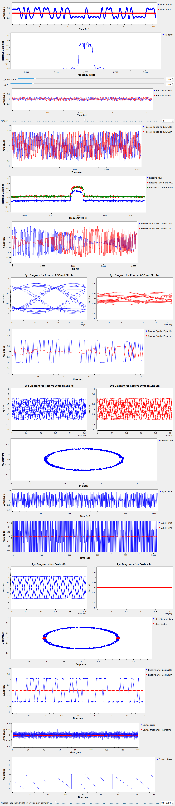

# Lesson 19 --- Carrier Phase Synchronization with a Costas Loop

<iframe width="560" height="315" src="https://www.youtube.com/embed/iUA4dRZww90" title="YouTube video player" frameborder="0" allow="accelerometer; autoplay; clipboard-write; encrypted-media; gyroscope; picture-in-picture" allowfullscreen></iframe>

Let's remind ourselves what a software-defined radio does to a real sinusoidal signal $$r(t)$$ at frequency $$f$$, with some arbitrary phase $$\phi$$,
\begin{equation}\label{eq:real-source}
  r(t) = A \cos(2\pi f t + \phi) 
\end{equation}
The SDR beats this signal against a local oscillator at frequency $$f_0$$ and produces a complex output signal
\begin{equation}\label{eq:shifted}
  z(t) = A e^{i(2\pi(f-f_0)t + \phi)}
\end{equation}
that preserves the original phase offset $$\phi$$ present in the real signal.

We have discussed how the clocks in the transmitter and receiver will not be synchronized, so that we must expect at least a modest frequency offset between the what was sent and what was (apparently) received; and we have seen how to use a [frequency-locked loop](lesson17.md) to remove most of the frequency offset.

The [frequency-locked loop](lesson17.md) leaves a small residual frequency error and an arbitrary phase, and the [symbol synchronizer](lesson18.md) gives us one sample per symbol. The last step is a **phase-locked loop** that rotates the constellation into its proper place: the **Costas loop**. Because it knows the constellation, it can lock onto a modulated signal (there is no un-modulated carrier to lock to). The price is an $$N$$-fold phase ambiguity, which we deal with in [Lesson 20](lesson20.md).

## Theory of the Costas loop

We will analyze for the case of quadrature phase-shift keying (QPSK), where the constellation of points we transmit lie on the unit circle in the complex plane along the diagonals, at phase angles of 45°, 135°, 225°, and 315°. As the receiver clock drifts gradually with respect to the transmitter clock, the phase of the received symbols will rotate slowly around the unit circle. The job of the Costas loop is to monitor and correct for this gradual rotation.

To manage this correction, the Costas loop needs to know the constellation of values that it is *supposed* to receive. For QPSK, they are the points with equal real and imaginary parts along the unit circle. When we measure something that doesn't have equal real and imaginary magnitudes, we know that we have rotated from the proper orientation. Assuming a perfect automatic gain control loop, the signal has unit magnitude and so only differs from the correct value by a pure rotation of $$e^{i\theta}$$ on the complex plane, where $$\theta$$ is the difference between the phase of the observed signal and the phase of the (nearest) constellation value. The loop uses that $$\theta$$ as its error signal, filters it, and advances a numerically-controlled oscillator that multiplies the input by $$e^{-i\hat\theta}$$.

## Loop settings

- **Order:** 2 for BPSK, 4 for QPSK (`constellation.arity()`). The loop then has 2 or 4 equally good lock points.
- **Loop bandwidth:** `2*math.pi/100` radians per *sample*. The Costas loop sits *after* the Symbol Sync, so one sample is one symbol and the loop averages over roughly 100 symbols. (In the Costas Loop flowgraph a slider sets this in cycles per sample; 0.01 is the same value.) If you put the Costas loop before the symbol synchronizer, at 16 samples per symbol, you would want a bandwidth about 16 times smaller.
- `lesson19a_SymbolSync_hand_tune.grc` has the FLL disabled and the frequency offset dialed in by hand with the `offset` slider, so you can see what the symbol synchronizer and Costas loop do on their own. The number in the slider (13.8 kHz) is the clock error between *my* Pluto and RTL-SDR; yours will be different.

<!-- flowgraphs:begin -->
## Flowgraphs

[`lesson19b_CostasLoop.grc`](https://github.com/gallicchio/learnSDR/blob/main/lesson19b_CostasLoop.grc)

{:target="_blank"}

Running:

{:target="_blank"}

Other flowgraphs for this lesson:

- [`lesson19a_SymbolSync_hand_tune.grc`](https://github.com/gallicchio/learnSDR/blob/main/lesson19a_SymbolSync_hand_tune.grc)
<!-- flowgraphs:end -->

All GNURadio flowgraphs are at [https://github.com/gallicchio/learnSDR](https://github.com/gallicchio/learnSDR)

