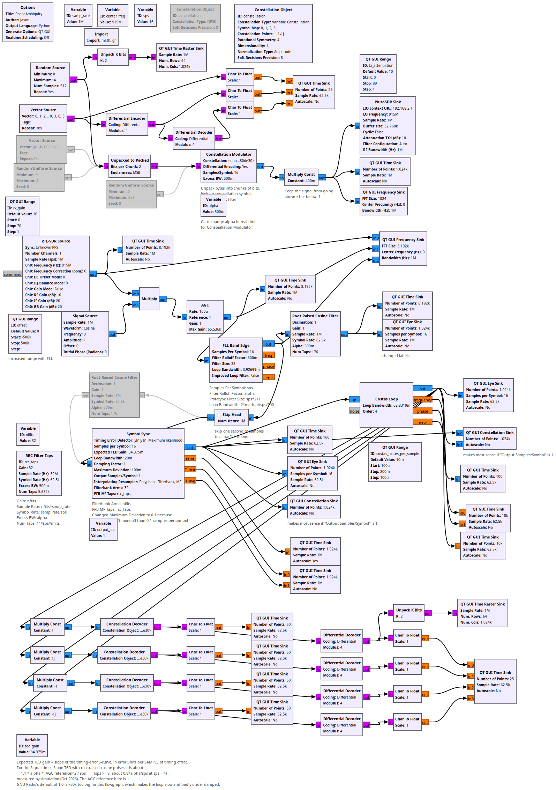
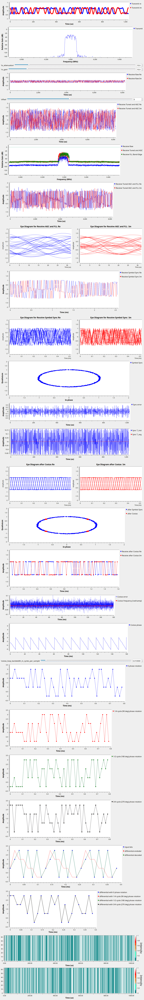

# Lesson 20 --- Resolving the Phase Ambiguity and Differential Encoding

<iframe width="560" height="315" src="https://www.youtube.com/embed/8uWNQCWeU0I" title="YouTube video player" frameborder="0" allow="accelerometer; autoplay; clipboard-write; encrypted-media; gyroscope; picture-in-picture" allowfullscreen></iframe>

The Costas loop can lock with the constellation rotated by any multiple of 90° (for QPSK). There is no way to tell from the signal alone which of the four rotations is "right". Two fixes:

1. **Differential encoding:** transmit the *change* in symbol from one symbol to the next rather than the symbol itself. A constant rotation then cancels in the receiver's differential decoder. This costs a little in noise performance (one wrong symbol produces two wrong differences). The **Constellation Modulator** has a *Differential Encoding* switch and the receiver uses a **Differential Decoder** with modulus `constellation.arity()`.
2. **A known preamble** (a sync word) that tells the receiver which rotation it is in. We don't do this here, but it is how most real packet modems work.

`lesson20_PhaseAmbiguity_and_DifferentialEncoding.grc` decodes the received symbols four times, each after an extra rotation by $$1, i, -1, -i$$, so you can watch which branch comes out right and that the differentially-decoded bits agree in all four. `lesson20_QPSK_modem.grc` is the compact version: AGC, FLL, Symbol Sync, **Constellation Receiver** (symbol sync's companion that combines the Costas loop with the decision), Differential Decoder, and unpacking to bits.

<!-- flowgraphs:begin -->
## Flowgraphs

[`lesson20_PhaseAmbiguity_and_DifferentialEncoding.grc`](https://github.com/gallicchio/learnSDR/blob/main/lesson20_PhaseAmbiguity_and_DifferentialEncoding.grc)

{:target="_blank"}

Running:

{:target="_blank"}

Other flowgraphs for this lesson:

- [`lesson20_QPSK_modem.grc`](https://github.com/gallicchio/learnSDR/blob/main/lesson20_QPSK_modem.grc) --- Running
<!-- flowgraphs:end -->

All GNURadio flowgraphs are at [https://github.com/gallicchio/learnSDR](https://github.com/gallicchio/learnSDR)

