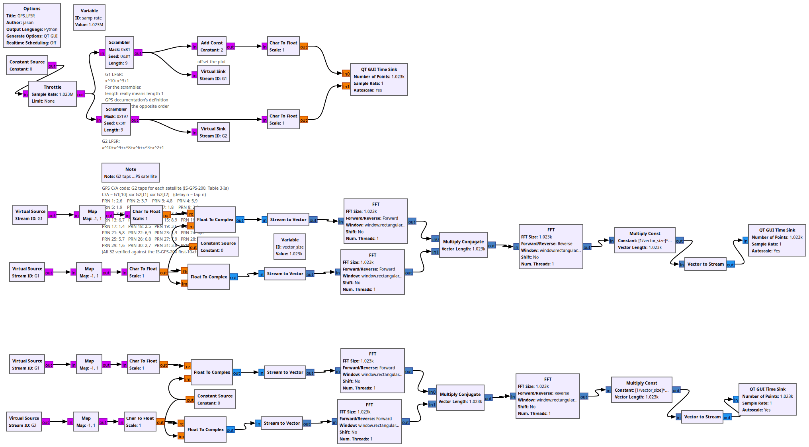
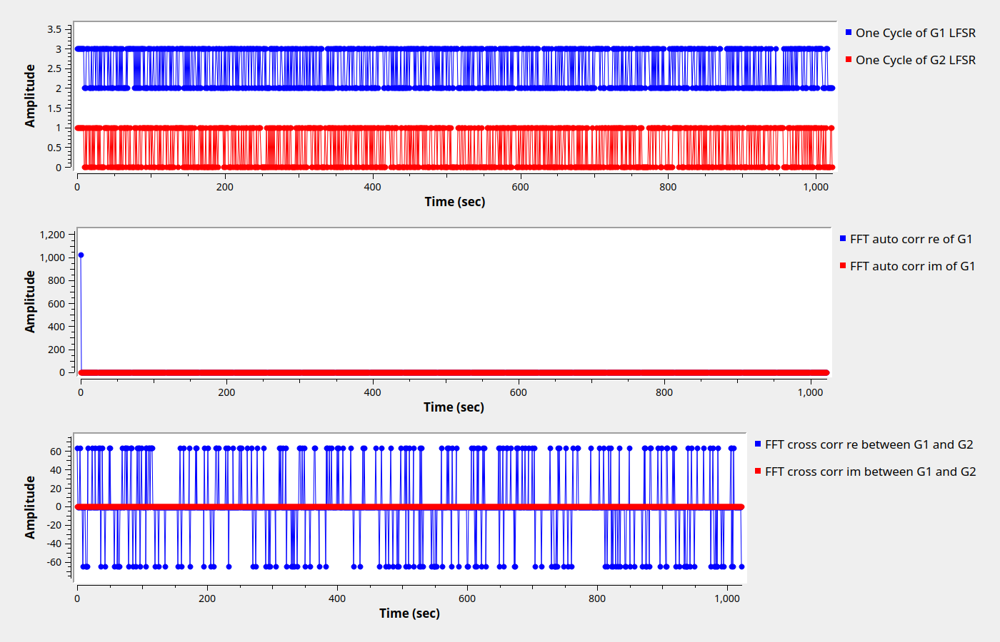

# Lesson 21 --- Linear Feedback Shift Registers (LFSR)

Pseudo-random numbers generated by a Linear Feedback Shift Registers (LFSRs) are useful in communications and are required-knowledge to see GPS transmissions.

<iframe width="560" height="315" src="https://www.youtube.com/embed/SVyTSfeO2do" title="YouTube video player" frameborder="0" allow="accelerometer; autoplay; clipboard-write; encrypted-media; gyroscope; picture-in-picture" allowfullscreen></iframe>

See also:

[Linear-feedback shift register - Wikipedia](https://en.wikipedia.org/wiki/Linear-feedback_shift_register)

<!-- flowgraphs:begin -->
## Flowgraphs

[`lesson21_GPS_LFSR.grc`](https://github.com/gallicchio/learnSDR/blob/main/lesson21_GPS_LFSR.grc)

{:target="_blank"}

Running:

{:target="_blank"}

Other flowgraphs for this lesson:

- [`lesson21_LFSR_investigation.grc`](https://github.com/gallicchio/learnSDR/blob/main/lesson21_LFSR_investigation.grc)
<!-- flowgraphs:end -->

All GNURadio flowgraphs are at [https://github.com/gallicchio/learnSDR](https://github.com/gallicchio/learnSDR)

