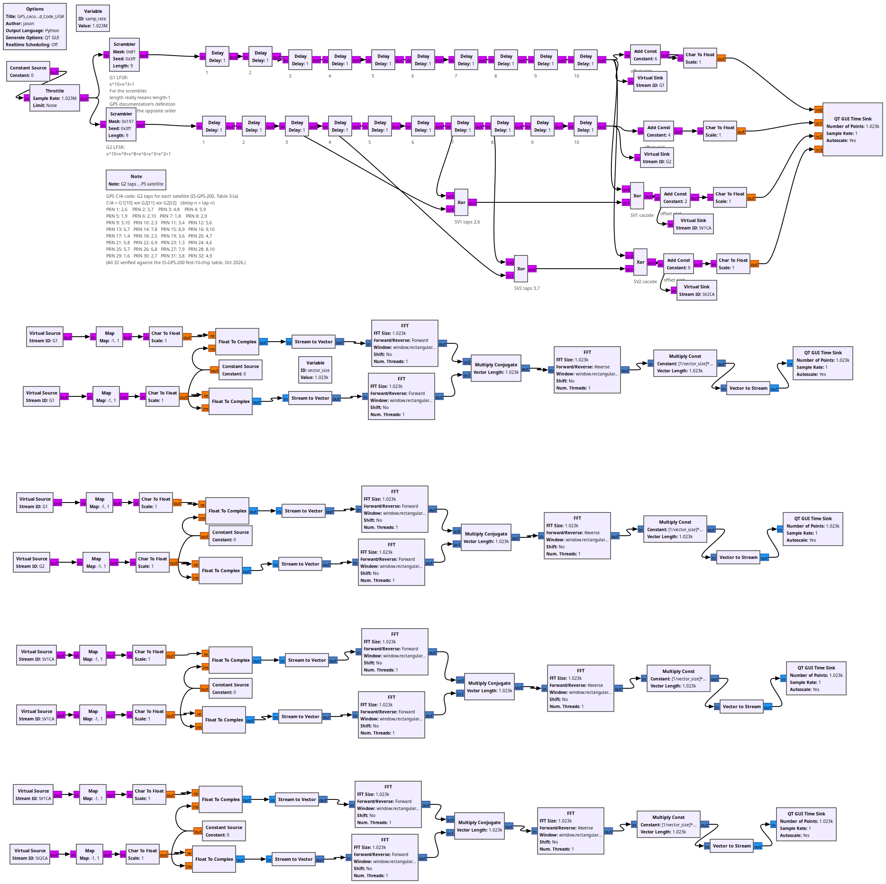
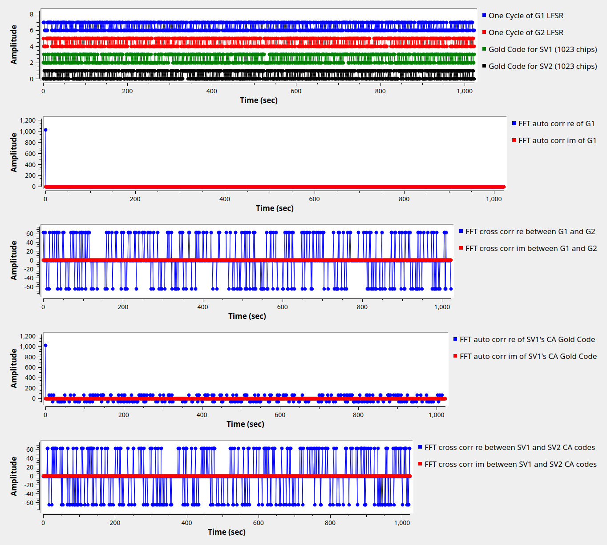

# Lesson 22 --- GPS Gold Codes; Spread Spectrum; Code-division multiple access (CDMA)

Gold Codes are XORed combinations of taps from Linear Feedback Shift Registers (LFSRs). This is used in spread-spectrum communications, including the Code-division multiple access (CDMA) that GPS satellites use.

<iframe width="560" height="315" src="https://www.youtube.com/embed/y09QMomxWYo" title="YouTube video player" frameborder="0" allow="accelerometer; autoplay; clipboard-write; encrypted-media; gyroscope; picture-in-picture" allowfullscreen></iframe>

The GPS reference used to find the taps for the C/A code is [http://www.naic.edu/~phil/rfi/gps/AFD-070803-059-1.pdf].

See also:

[Gold code - Wikipedia](https://en.wikipedia.org/wiki/Gold_code)

<!-- flowgraphs:begin -->
## Flowgraphs

[`lesson22_GPS_cacode_Gold_Code_LFSR.grc`](https://github.com/gallicchio/learnSDR/blob/main/lesson22_GPS_cacode_Gold_Code_LFSR.grc)

{:target="_blank"}

Running:

{:target="_blank"}

Other flowgraphs for this lesson:

- [`lesson22_GPS_cacode_Gold_Code_LFSR_check_known_cacodes.grc`](https://github.com/gallicchio/learnSDR/blob/main/lesson22_GPS_cacode_Gold_Code_LFSR_check_known_cacodes.grc)
<!-- flowgraphs:end -->

All GNURadio flowgraphs are at [https://github.com/gallicchio/learnSDR](https://github.com/gallicchio/learnSDR)

