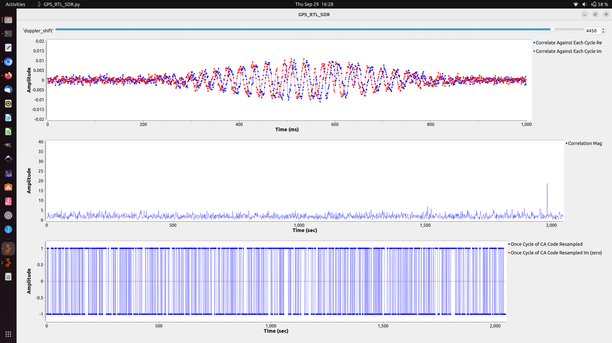
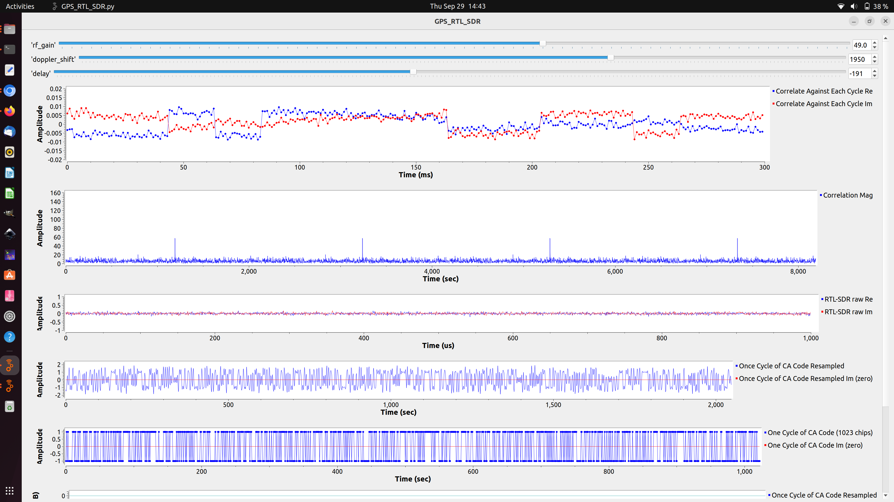
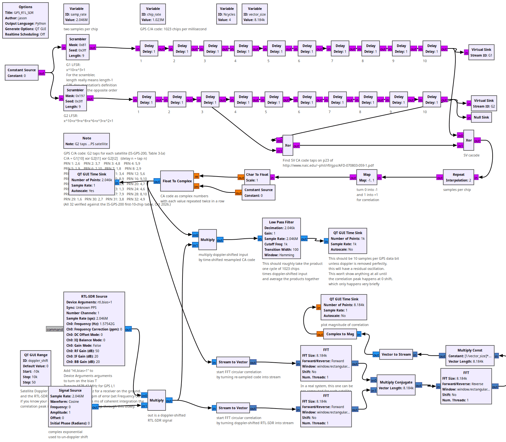

# Lesson 23 --- GPS Reception

I use an RTL-SDR and a cheap GPS antenna to see some some of the Global Positioning System (GPS) satellite transmissions.

<iframe width="560" height="315" src="https://www.youtube.com/embed/4YO1XSVMtqI" title="YouTube video player" frameborder="0" allow="accelerometer; autoplay; clipboard-write; encrypted-media; gyroscope; picture-in-picture" allowfullscreen></iframe>

The GPS reference used to find the taps for the C/A code is <http://www.naic.edu/~phil/rfi/gps/AFD-070803-059-1.pdf> (IS-GPS-200, Table 3-Ia). The flowgraphs now carry a note with the two G2 taps for all 32 satellites; the table and the delay-chain construction in the flowgraphs were checked against the published first-ten-chips column for every PRN.

## Practicalities

- **Antenna.** You need an *active* GPS antenna (one with a built-in amplifier). The RTL-SDR v3/v4 can power it through the coax: add `bias=1` to the RTL-SDR Source's device arguments (`rtl,bias=1`), as the flowgraphs do. Put the antenna where it can see the sky.
- **Doppler.** A satellite's Doppler shift at L1 is up to about ±5 kHz, and on top of that the RTL-SDR's own clock error moves everything by 1.575 kHz per ppm. The `doppler_shift` slider therefore spans ±10 kHz. If you know your dongle's ppm error (from Lesson 2 or a known station), enter it as *Frequency Correction (ppm)* so the search stays near zero. With `Ncycles` = 4 ms of coherent integration the correlation peak is only ~250 Hz wide, so step the slider slowly, or increase the step size and reduce `Ncycles` for a first look.
- **Which satellites?** Use any GPS status app or <https://in-the-sky.org/satmap_radar.php> to see which PRNs are overhead; a satellite that is below the horizon will never show up no matter what the taps are.

GPS correlation and demodulation in operation:

A more sophisticated result with better fine-tuning of the carrier offset:

<!-- flowgraphs:begin -->
## Flowgraphs

[`lesson23_GPS_RTL_SDR_calculateCA_simplified.grc`](https://github.com/gallicchio/learnSDR/blob/main/lesson23_GPS_RTL_SDR_calculateCA_simplified.grc)

{:target="_blank"}

Other flowgraphs for this lesson:

- [`lesson23_GPS_RTL_SDR_calculateCA_shift.grc`](https://github.com/gallicchio/learnSDR/blob/main/lesson23_GPS_RTL_SDR_calculateCA_shift.grc)
- [`lesson23_GPS_RTL_SDR_from_known_cacodes.grc`](https://github.com/gallicchio/learnSDR/blob/main/lesson23_GPS_RTL_SDR_from_known_cacodes.grc)
- [`lesson23_GPS_RTL_SDR_calculateCA_old_resampled.grc`](https://github.com/gallicchio/learnSDR/blob/main/lesson23_GPS_RTL_SDR_calculateCA_old_resampled.grc)
<!-- flowgraphs:end -->

All GNURadio flowgraphs are at [https://github.com/gallicchio/learnSDR](https://github.com/gallicchio/learnSDR)

