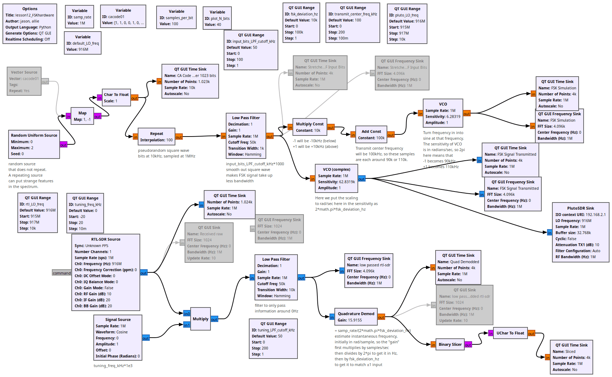
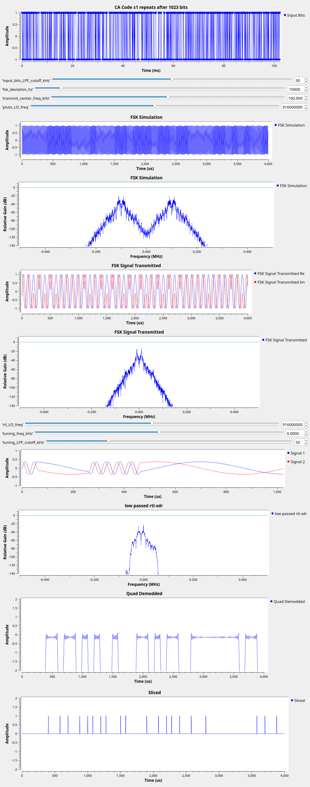

# Lesson 24 --- Frequency-Shift Keying (FSK)

> **No video for this lesson.** Lessons 24--33 were drafted in October 2026 with the help of an AI assistant (Claude) in the spirit of the lessons above, and tested on the same RTL-SDR / PlutoSDR / B210 setup. They are less polished than the video lessons; corrections and pull requests are welcome.

(The flowgraph is Jason's from 2022; only this page is new.)

So far every digital modulation put the bits into the *amplitude* or *phase* of the carrier. FSK puts them into the *frequency*: a 1 is a tone a little above the carrier, a 0 a tone a little below. The transmitter is just the **VCO** block (voltage-controlled oscillator) from Lesson 8b's radar: the bit stream, smoothed a little by a low-pass filter and scaled to ±`fsk_deviation_hz`, is the frequency we ask it to produce.

The receiver is equally simple: the **Quadrature Demod** block outputs the phase change from one sample to the next, which is the instantaneous frequency. Scale it so the two tones come out as ±1 (`samp_rate/(2π·deviation)`), low-pass filter, slice at zero, and the bits are back. Notice what is *not* there: no Costas loop. FSK does not care about the carrier phase, only about frequency, and a frequency error between Pluto and RTL-SDR just shifts the demodulator output up or down (the `tuning_freq_kHz` slider cancels it; Lesson 25 does this automatically).

The price is bandwidth: two tones 20 kHz apart switching every 100 µs use far more spectrum than the 10 kbit/s deserve. Lesson 25 makes FSK efficient.

## Things to try

- Reduce `fsk_deviation_hz` until the demodulator can no longer tell the tones apart. The ratio deviation / bit rate is the *modulation index* $$h$$; here $$h = 2$$.
- Pagers (POCSAG) and AX.25 packet radio are 2-FSK at 1200 bit/s; with an RTL-SDR and the `multimon-ng` program you can decode real ones.

<!-- flowgraphs:begin -->
## Flowgraphs

[`lesson24_FSKhardware.grc`](https://github.com/gallicchio/learnSDR/blob/main/lesson24_FSKhardware.grc)

{:target="_blank"}

Running: 2-FSK from the Pluto, demodulated by the RTL-SDR; the top trace is the sliced bits:

{:target="_blank"}
<!-- flowgraphs:end -->

All GNURadio flowgraphs are at [https://github.com/gallicchio/learnSDR](https://github.com/gallicchio/learnSDR)
