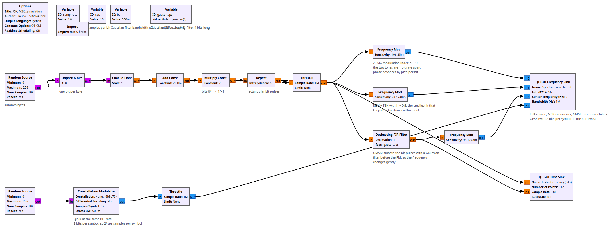
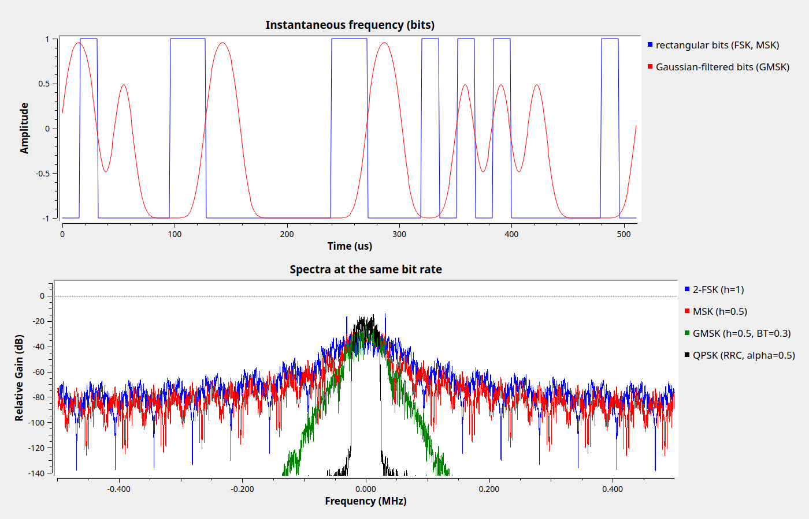

# Lesson 25 --- MSK and GMSK: FSK done efficiently

> **No video for this lesson.** Lessons 24--38 were drafted in October 2026 with the help of an AI assistant (Claude) in the spirit of the lessons above, and tested on the same RTL-SDR / PlutoSDR / B210 setup. They are less polished than the video lessons; corrections and pull requests are welcome.

Lesson 24's FSK switches between two tones $$\pm h/(2T_b)$$ away from the carrier, where $$T_b$$ is the bit time and $$h$$ is the modulation index. Two things make it wasteful: the tones are far apart, and the frequency jumps abruptly at every bit edge, which splatters power far from the carrier (Lesson 14 again: sharp edges in time mean wide spectra).

- **MSK** (minimum-shift keying) uses $$h = 0.5$$, the smallest value for which the two tones are still orthogonal over one bit. The phase advances or retreats by exactly 90° per bit and is continuous, so the envelope is perfectly constant.
- **GMSK** additionally passes the bit stream through a **Gaussian** low-pass filter before the frequency modulator, so the frequency moves smoothly instead of jumping. The filter's bandwidth times the bit time, `BT`, sets how much the bits are smeared into each other (GSM uses 0.3, Bluetooth 0.5). The sidelobes vanish; the price is a little intersymbol interference.
- Constant envelope is the big attraction: the power amplifier can be run flat out (non-linear) without distorting the signal. That is why GSM, Bluetooth, AIS and many satellite links use it.

`lesson25a_FSK_MSK_GMSK_spectra.grc` builds all three from parts (bits → Gaussian filter → **Frequency Modulator** with sensitivity $$\pi h/\texttt{sps}$$) and plots their spectra at the same bit rate, next to QPSK for comparison.

`lesson25b_GMSK_Pluto_to_RTL.grc` sends GMSK over the air using GNU Radio's **GMSK Mod** block and demodulates it like Lesson 24: channel filter about one bit-rate wide, **Quadrature Demod**, then a **DC Blocker** --- the frequency error between the two radios appears as a DC offset after FM demodulation, and this high-pass filter removes it (it plays the role of the FLL of Lesson 17). The **Symbol Sync** block (Lesson 18, float version, Mueller & Müller detector) picks one sample per bit and a slicer turns it into bits. The TED gain of 0.06 was measured in simulation for this signal, as in Lesson 18.

## Things to try

- In 25a, change `bt` to 0.5 and to 10 (which is just MSK). Change the FSK branch's $$h$$ to 2, the value Lesson 24 used.
- In 25b, lower `tx_attenuation` until the eye closes. How does the bit error rate compare with BPSK (Lesson 18) at the same power? (FM demodulation "throws away" about 3 dB.)

<!-- flowgraphs:begin -->
## Flowgraphs

[`lesson25a_FSK_MSK_GMSK_spectra.grc`](https://github.com/gallicchio/learnSDR/blob/main/lesson25a_FSK_MSK_GMSK_spectra.grc)

{:target="_blank"}

Running: spectra of 2-FSK, MSK, GMSK and QPSK at the same bit rate, and the rectangular vs. Gaussian-filtered bit streams:

{:target="_blank"}

Other flowgraphs for this lesson:

- [`lesson25b_GMSK_Pluto_to_RTL.grc`](https://github.com/gallicchio/learnSDR/blob/main/lesson25b_GMSK_Pluto_to_RTL.grc) --- Running over the air: demodulated bits, FM-demodulator output before/after the DC blocker, spectra, eye diagram
<!-- flowgraphs:end -->

All GNURadio flowgraphs are at [https://github.com/gallicchio/learnSDR](https://github.com/gallicchio/learnSDR)
