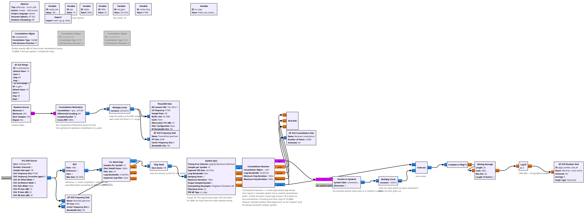
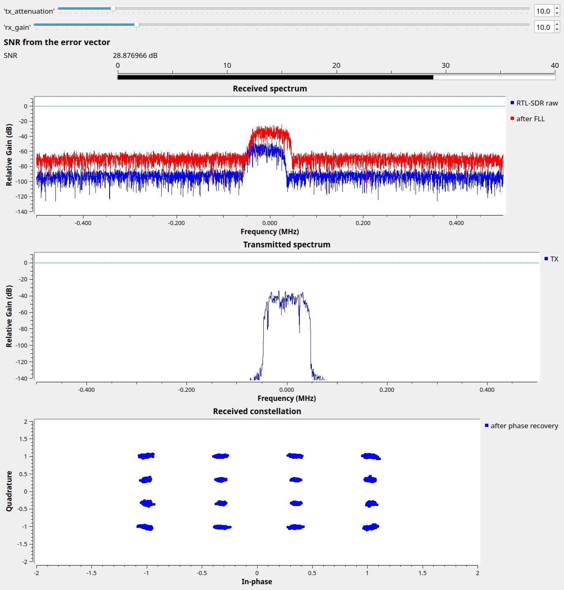

# Lesson 26 --- More bits per symbol: 8PSK and 16-QAM

> **No video for this lesson.** Lessons 24--33 were drafted in October 2026 with the help of an AI assistant (Claude) in the spirit of the lessons above, and tested on the same RTL-SDR / PlutoSDR / B210 setup. They are less polished than the video lessons; corrections and pull requests are welcome.

QPSK sends 2 bits per symbol. If the symbol rate (and so the bandwidth, Lesson 14) is fixed, the only way to send faster is to use more constellation points: **8PSK** has 8 points on the circle (3 bits per symbol), **16-QAM** has a 4×4 grid with three different amplitudes (4 bits per symbol), 64-QAM a 8×8 grid, and so on up to the 1024-QAM of cable modems and Wi-Fi 6.

Nothing is free: the points get closer together, so the same noise causes more decision errors. Going from QPSK to 16-QAM needs about 4 dB more signal-to-noise ratio for the same error rate, 64-QAM about 8.5 dB more. That is why your Wi-Fi or phone *negotiates* the constellation: dense when the signal is strong, QPSK when it is weak.

The flowgraph is Lesson 20's modem with three **Constellation Object** blocks (enable one): QPSK, 8PSK, 16-QAM. Two things change in the receiver:

- The plain **Costas Loop** of Lesson 19 only knows about PSK; for QAM we use the **Constellation Receiver** block, whose phase error is simply "received symbol minus nearest constellation point". It works for any constellation and also outputs the decided symbol.
- The **AGC** reference of 1 now matters: GNU Radio normalizes its 8PSK and 16-QAM points to mean amplitude 1, and the receiver has to see the rings at the right radii.

An **error vector** chain at the bottom (received symbol minus ideal symbol, averaged) gives a live SNR estimate, as in Lesson 27.

## Things to try

- Raise `tx_attenuation` until the 16-QAM clusters merge, note the SNR; switch to QPSK and do the same.
- 8PSK with the Costas loop set to order 8 also works; try replacing the Constellation Receiver to see.
- Why does 16-QAM, unlike PSK, not have a constant envelope? Look at the transmitted time signal.

<!-- flowgraphs:begin -->
## Flowgraphs

[`lesson26_QAM_Pluto_to_RTL.grc`](https://github.com/gallicchio/learnSDR/blob/main/lesson26_QAM_Pluto_to_RTL.grc)

{:target="_blank"}

Running over the air with 16-QAM: the 4x4 grid after phase recovery, and the error-vector SNR meter:

{:target="_blank"}
<!-- flowgraphs:end -->

All GNURadio flowgraphs are at [https://github.com/gallicchio/learnSDR](https://github.com/gallicchio/learnSDR)
