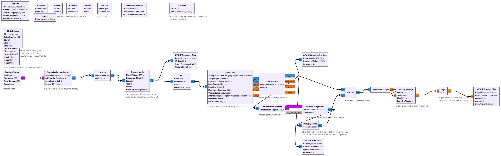
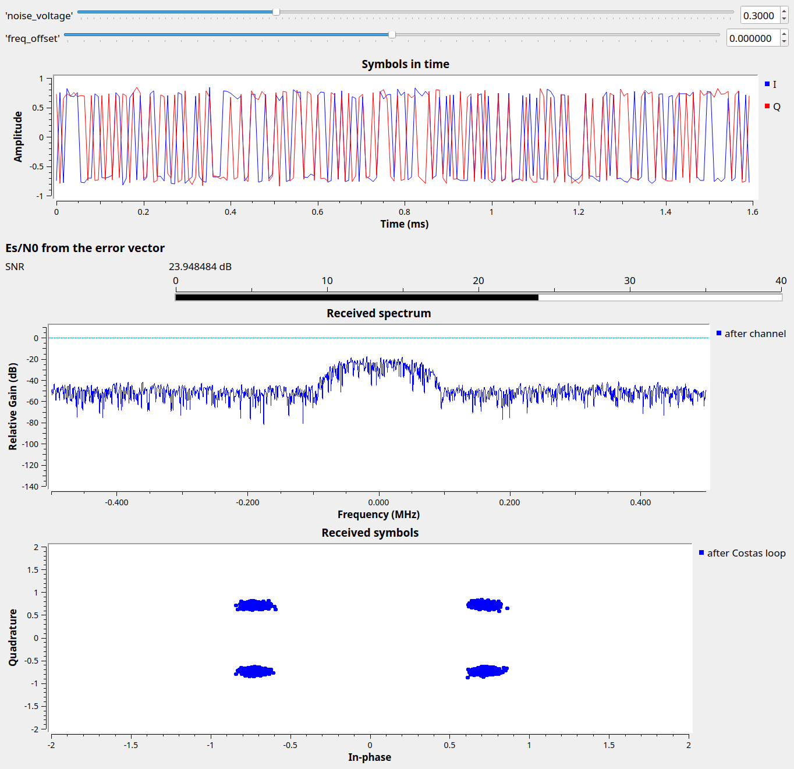

# Lesson 27 --- Noise, SNR and what the constellation tells you (simulation)

> **No video for this lesson.** Lessons 24--33 were drafted in October 2026 with the help of an AI assistant (Claude) in the spirit of the lessons above, and tested on the same RTL-SDR / PlutoSDR / B210 setup. They are less polished than the video lessons; corrections and pull requests are welcome.

Every lesson so far used strong signals. This one adds controlled noise in simulation so you can see what the receiver chain of Lessons 16--19 does as the signal-to-noise ratio drops.

The **Channel Model** block adds complex white Gaussian noise with RMS voltage `noise_voltage` to every sample (and, optionally, a carrier frequency offset). The transmitted QPSK symbols have unit energy, spread over `sps` samples, so the energy-per-symbol to noise-density ratio is
\begin{equation}
  E_s/N_0 \approx 10 \log_{10}\frac{4\,\texttt{sps}}{\texttt{noise\_voltage}^2}\ \text{dB}
\end{equation}
(the factor 4 is the power of GNU Radio's QPSK points, ±1±j). With `sps` = 8: 35 dB at 0.1, 21 dB at 0.5, 15 dB at 1.0.

The receiver is the usual AGC → Symbol Sync → Costas loop. The bottom chain measures the SNR the way a real modem does: it decides which constellation point each received symbol is closest to, subtracts that ideal point to get the **error vector**, averages its power over 2000 symbols, and converts to dB (the signal power is 1 after the AGC). This *error vector magnitude* is what cable and Wi-Fi equipment reports as "MER".

## Things to try

- Where do the four QPSK clusters start to touch? (Around 10 dB.) Where does the Costas loop lose lock?
- Doubling `noise_voltage` costs 6 dB. Check it with the meter.
- Add a frequency offset of 0.002 (2 kHz): the FLL is not in this flowgraph, so the Costas loop has to pull it in on its own. How far can you go?
- The estimate reads a little low at high SNR because the loops themselves add jitter; compare with the formula.

<!-- flowgraphs:begin -->
## Flowgraphs

[`lesson27_Noise_SNR_Constellation.grc`](https://github.com/gallicchio/learnSDR/blob/main/lesson27_Noise_SNR_Constellation.grc)

{:target="_blank"}

Running with noise_voltage = 0.3 (about 25 dB Es/N0): the clusters spread and the meter reads 24 dB:

{:target="_blank"}
<!-- flowgraphs:end -->

All GNURadio flowgraphs are at [https://github.com/gallicchio/learnSDR](https://github.com/gallicchio/learnSDR)
