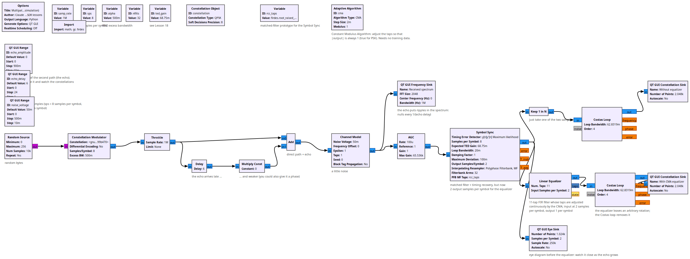
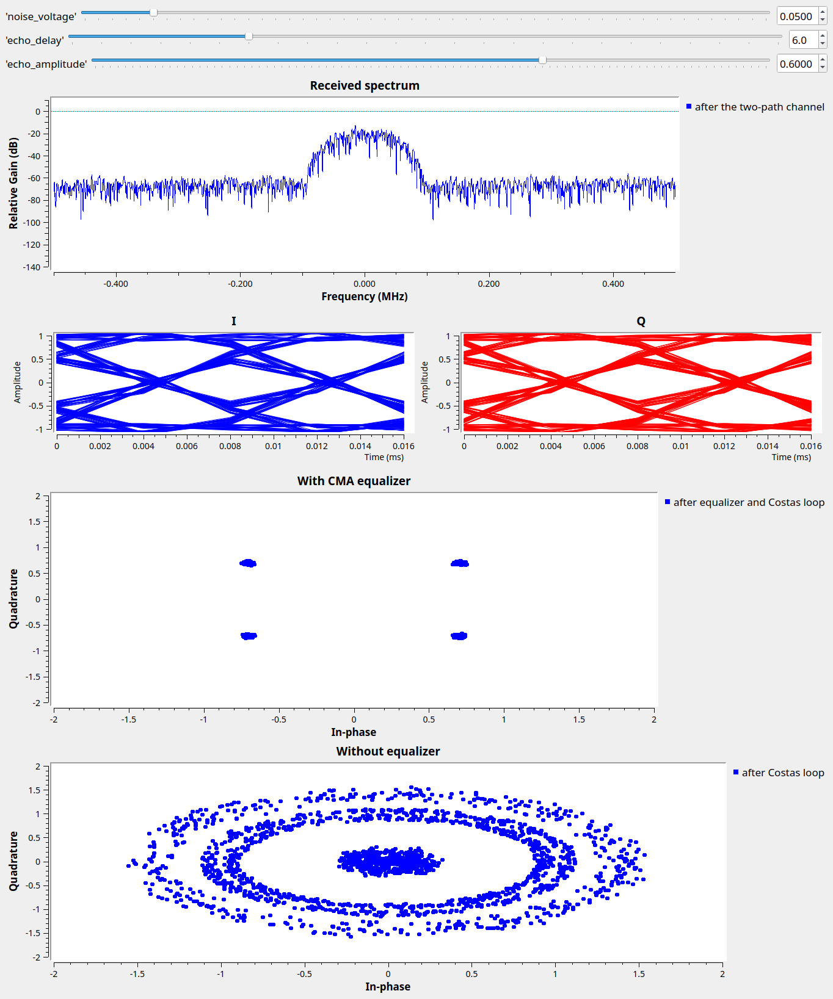

# Lesson 28 --- Multipath and a simple adaptive equalizer (simulation)

> **No video for this lesson.** Lessons 24--33 were drafted in October 2026 with the help of an AI assistant (Claude) in the spirit of the lessons above, and tested on the same RTL-SDR / PlutoSDR / B210 setup. They are less polished than the video lessons; corrections and pull requests are welcome.

Indoors, a radio signal arrives several times: directly, and via reflections from walls and furniture a little later. The receiver sees the sum. This flowgraph builds the simplest such channel from blocks you know: the signal plus a copy **Delay**ed by `echo_delay` samples and scaled by `echo_amplitude`.

Two things happen. In frequency, the echo puts a ripple on the spectrum with nulls every $$1/\tau$$ (watch the spectrum sink as you raise the amplitude) --- the channel is now *frequency selective*. In time, each symbol leaks into the next: intersymbol interference. The eye diagram closes and the QPSK constellation turns into a mess of rings, even though there is almost no noise.

The fix is an **equalizer**: an FIR filter that approximately undoes the channel. Since the channel is unknown, the filter's taps are found *adaptively*. The **Linear Equalizer** block here uses the **constant modulus algorithm** (CMA): it nudges the 11 taps, every symbol, in the direction that makes $$|y|$$ closer to 1 --- which must be true for any PSK signal. It needs no training data, which is why it is popular for broadcast-type signals. The equalizer runs at 2 samples per symbol (a *fractionally spaced* equalizer, so it also fixes small timing errors) and leaves an arbitrary rotation, which the Costas loop after it removes.

## Things to try

- `echo_delay` = 8 (exactly one symbol) with amplitude 0.9: the hardest case. Then 16.
- The CMA `step_size` is a loop bandwidth: too small and it never converges, too large and the taps jitter. Try 0.0005 and 0.02.
- OFDM (Lesson 30) is the other way of dealing with multipath.

<!-- flowgraphs:begin -->
## Flowgraphs

[`lesson28_Multipath_Equalizer.grc`](https://github.com/gallicchio/learnSDR/blob/main/lesson28_Multipath_Equalizer.grc)

{:target="_blank"}

Running with a 0.6-amplitude echo 6 samples late: without the equalizer the constellation is rings; with the CMA equalizer the four points are back:

{:target="_blank"}
<!-- flowgraphs:end -->

All GNURadio flowgraphs are at [https://github.com/gallicchio/learnSDR](https://github.com/gallicchio/learnSDR)
