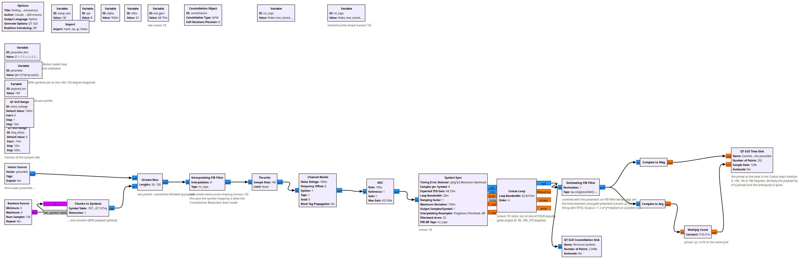
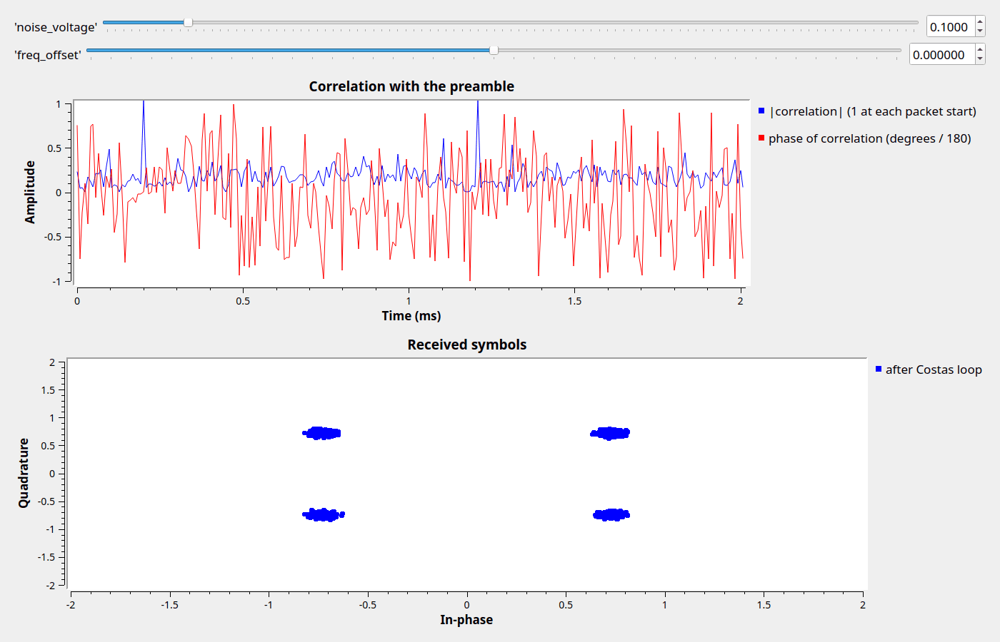

# Lesson 29 --- Finding packets and the phase ambiguity with a known preamble (simulation)

> **No video for this lesson.** Lessons 24--33 were drafted in October 2026 with the help of an AI assistant (Claude) in the spirit of the lessons above, and tested on the same RTL-SDR / PlutoSDR / B210 setup. They are less polished than the video lessons; corrections and pull requests are welcome.

Lesson 20 removed the Costas loop's 90° ambiguity with differential encoding. Real packet radios do it differently: every packet starts with a **preamble** the receiver knows. Correlating the received symbols with the preamble gives a sharp peak at the start of every packet, and the *phase* of that peak is exactly the rotation the Costas loop has settled on.

The transmitter builds packets in the symbol domain: a **Stream Mux** alternates between a **Vector Source** holding the preamble (a 13-chip **Barker code**, twice, as QPSK symbols) and random payload symbols, and an interpolating **root-raised-cosine** filter shapes the pulses (this is what the Constellation Modulator does inside, Lesson 15). The receiver is Lessons 18 and 19, followed by one new block: an **FIR filter whose taps are the time-reversed, conjugated preamble**. A filter like that *is* a correlator (Lesson 22 did the same thing with FFTs). Its output has magnitude 1 at each packet start and noise-like values elsewhere; the output's phase at the peak is 0°, ±90° or 180°.

Barker codes are used because their correlation sidelobes are as small as possible (1/13); Wi-Fi, LTE and GPS all use sequences with this property.

## Things to try

- Multiply the payload by $$e^{-i\theta}$$ with $$\theta$$ the phase at the peak and the ambiguity is gone. (Homework: hold the phase with a **Sample and Hold** block triggered at the peak.)
- Shorten the preamble to one Barker code: the peaks get noisier. Lengthen it: how many symbols do you waste per packet?
- GNU Radio's **Correlation Estimator** block does all of this (and more) in one block and tags the stream with the packet start and phase.

<!-- flowgraphs:begin -->
## Flowgraphs

[`lesson29_Preamble_Correlation.grc`](https://github.com/gallicchio/learnSDR/blob/main/lesson29_Preamble_Correlation.grc)

{:target="_blank"}

Running: the correlation magnitude is 1 at every packet start (every 126 symbols), noise-like elsewhere:

{:target="_blank"}
<!-- flowgraphs:end -->

All GNURadio flowgraphs are at [https://github.com/gallicchio/learnSDR](https://github.com/gallicchio/learnSDR)
