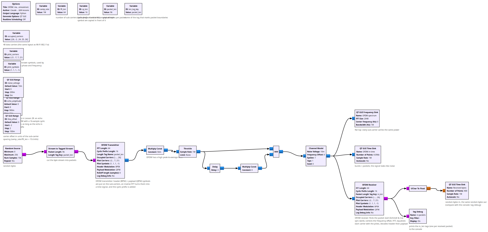
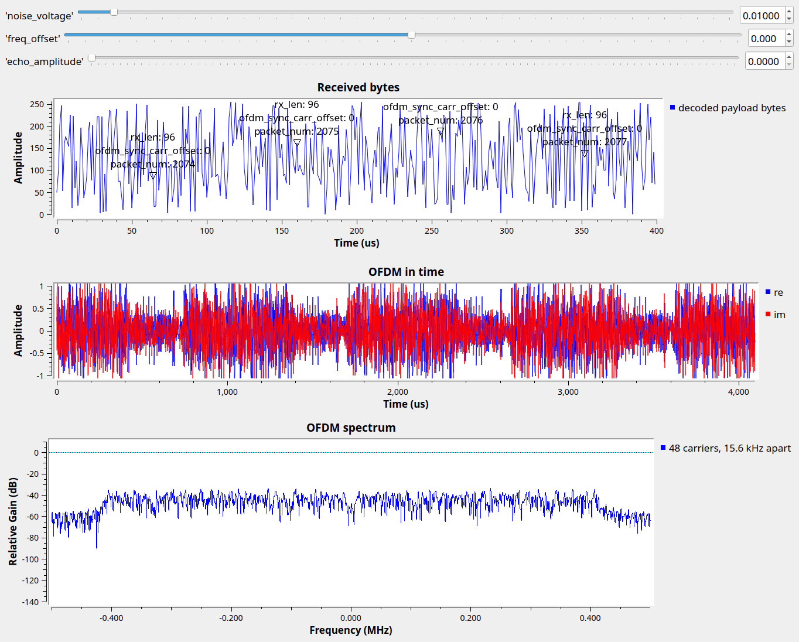

# Lesson 30 --- OFDM: many slow carriers instead of one fast one (simulation)

> **No video for this lesson.** Lessons 24--38 were drafted in October 2026 with the help of an AI assistant (Claude) in the spirit of the lessons above, and tested on the same RTL-SDR / PlutoSDR / B210 setup. They are less polished than the video lessons; corrections and pull requests are welcome.

Lesson 28 showed that an echo a fraction of a symbol long wrecks a single-carrier signal. **Orthogonal frequency-division multiplexing** takes the opposite approach: instead of one carrier at 1 Msymbol/s, use 48 carriers at 15.6 ksymbol/s each. Each symbol is now 64 µs long, so an echo of a microsecond barely matters. The carriers are spaced exactly one symbol rate apart, which makes them orthogonal --- an FFT separates them perfectly --- and the transmitter is just an inverse FFT of the symbols you want on each carrier.

Two tricks make it work: a **cyclic prefix** (the last 16 samples of every symbol are copied in front of it) absorbs any echo shorter than 16 samples, and a few **pilot carriers** with known symbols let the receiver measure and undo the channel's phase and amplitude on every carrier. Wi-Fi, LTE/5G, DVB-T and DAB are all OFDM; this flowgraph uses the Wi-Fi 802.11a carrier layout.

GNU Radio's **OFDM Transmitter** and **OFDM Receiver** hier blocks do the heavy lifting (packet detection with a Schmidl & Cox sync word, frequency correction, FFT, equalization, header and payload decoding). Random bytes go in as 96-byte packets; the receiver prints a tag per decoded packet and the bytes come out on the time sink.

## Things to try

- Raise `echo_amplitude` to 0.9: the Lesson 28 echo (3 samples) is harmless. Change the Delay block to 20 samples (longer than the prefix) and it is not.
- `freq_offset` is in units of the carrier spacing: the receiver copes with ±½, larger offsets need the sync word's coarse correction.
- OFDM has a large peak-to-average power ratio (look at the time sink), which is why the signal is scaled to 0.05 before the Pluto.
- `lesson30b_OFDM_Pluto_to_RTL.grc` is the same thing over the air at 915 MHz: the OFDM receiver's sync word and pilots absorb the Pluto/RTL-SDR clock difference (about one carrier spacing) without any help, and the 96-byte packets come out decoded.

<!-- flowgraphs:begin -->
## Flowgraphs

[`lesson30_OFDM.grc`](https://github.com/gallicchio/learnSDR/blob/main/lesson30_OFDM.grc)

{:target="_blank"}

Running: flat-topped OFDM spectrum, bursty time signal, and the decoded payload bytes:

{:target="_blank"}

Other flowgraphs for this lesson:

- [`lesson30b_OFDM_Pluto_to_RTL.grc`](https://github.com/gallicchio/learnSDR/blob/main/lesson30b_OFDM_Pluto_to_RTL.grc) --- over the air, Pluto to RTL-SDR at 915 MHz: packets decode (packet_num tags on the byte plot)
<!-- flowgraphs:end -->

All GNURadio flowgraphs are at [https://github.com/gallicchio/learnSDR](https://github.com/gallicchio/learnSDR)
