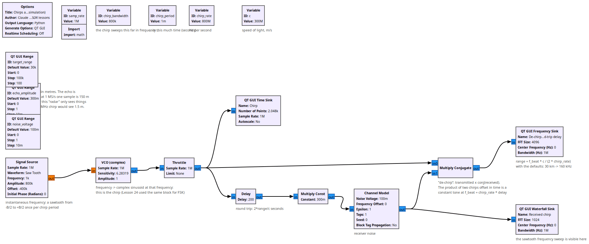
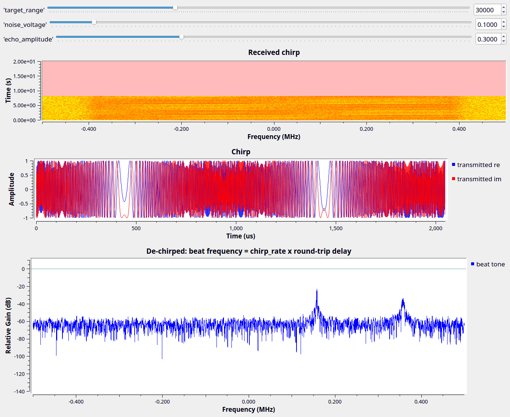

# Lesson 31 --- Chirps and FMCW radar (simulation)

> **No video for this lesson.** Lessons 24--33 were drafted in October 2026 with the help of an AI assistant (Claude) in the spirit of the lessons above, and tested on the same RTL-SDR / PlutoSDR / B210 setup. They are less polished than the video lessons; corrections and pull requests are welcome.

Lesson 8b measured *speed* from the Doppler shift of a tone. To measure *distance* you need to know *when* the echo arrived, and a tone has no "when". A **chirp** --- a tone whose frequency sweeps linearly, here from $$-B/2$$ to $$+B/2$$ every `chirp_period` --- does. The transmitter is Lesson 24's **VCO** driven by a sawtooth.

The clever part is the receiver: multiply the received signal by the conjugate of what is being transmitted *right now* (the **Multiply Conjugate** block). Two chirps that are offset in time by $$\tau$$ differ in frequency by a constant $$f_\text{beat} = (B/T)\,\tau$$, so the product is a pure tone whose frequency is proportional to the round-trip delay, and therefore to range:
\begin{equation}
  R = \frac{c\,\tau}{2} = \frac{c\,f_\text{beat}}{2B/T}
\end{equation}
An FFT of the de-chirped signal is the range profile; every target becomes a peak. This is frequency-modulated continuous-wave (FMCW) radar, used in car radars, altimeters and level gauges. The range resolution is $$c/(2B)$$: with the 800 kHz chirp here that is 190 m, which is why the "target" is 30 km away; a 24 GHz car radar sweeps 200 MHz and resolves 75 cm.

The second, weaker peak in the spectrum comes from the part of each period where the transmitter has already restarted its sweep but the echo has not --- real radars blank that part out.

## Things to try

- Move `target_range` and check the beat frequency against the formula. What happens beyond 94 km?
- Shorten `chirp_period`: the beat frequency grows (steeper slope); the sawtooth-wrap peak grows too.
- LoRa uses the same chirps for *communication*: each symbol is a chirp with a different starting frequency, and the receiver de-chirps and takes an FFT exactly as here.
- With a Pluto you can do this over the air (Lesson 8b's TX/RX), but with its 20 MHz maximum bandwidth you would only resolve 7.5 m.

<!-- flowgraphs:begin -->
## Flowgraphs

[`lesson31_Chirp_FMCW_Radar.grc`](https://github.com/gallicchio/learnSDR/blob/main/lesson31_Chirp_FMCW_Radar.grc)

{:target="_blank"}

Running: a target at 30 km gives a 160 kHz beat tone; the sawtooth sweep is visible in the waterfall:

{:target="_blank"}
<!-- flowgraphs:end -->

All GNURadio flowgraphs are at [https://github.com/gallicchio/learnSDR](https://github.com/gallicchio/learnSDR)
