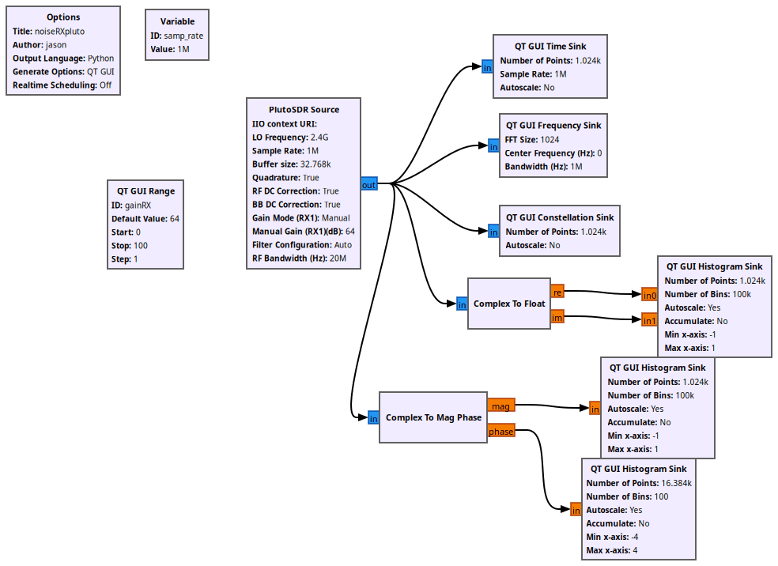
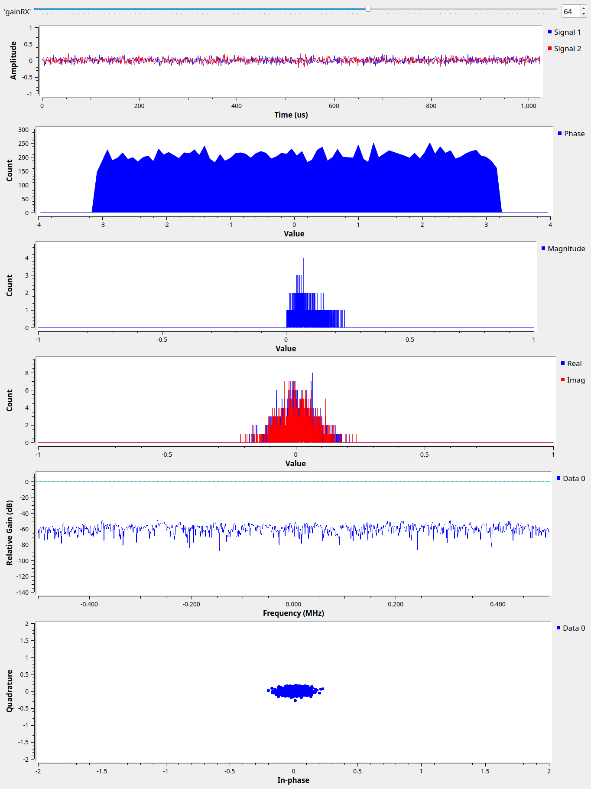

# Lesson 32 --- What a receiver sees when nothing is there: noise

> **No video for this lesson.** Lessons 24--38 were drafted in October 2026 with the help of an AI assistant (Claude) in the spirit of the lessons above, and tested on the same RTL-SDR / PlutoSDR / B210 setup. They are less polished than the video lessons; corrections and pull requests are welcome.

(The two flowgraphs are Jason's from 2021; only this page is new.)

Disconnect the antenna and a receiver still produces samples: noise, from the thermal motion of electrons in the amplifiers and from the digitizer itself. `lesson32a_noiseRXpluto.grc` shows the Pluto's, `lesson32b_noiseRXsim.grc` makes the same picture with GNU Radio's **Noise Source**.

- The **histogram** of the real part is a Gaussian bell: lots of independent small contributions. Its width is the noise voltage; the spectrum sink's flat floor is the same thing per frequency bin.
- Turn the RX gain up and the floor rises: you are amplifying the front end's noise. Turn it far down and the floor stops dropping and the histogram becomes "steppy": you are now looking at the ADC's quantization (the RTL-SDR has 8 bits, the Pluto 12).
- A signal is detectable when it sticks out of this floor. Averaging more FFTs (the sink's "average" setting) does not lower the floor, it only makes it smoother; narrower FFT bins (a bigger FFT size) *do* lower the noise per bin, by 3 dB per doubling, because less noise falls into each bin while a tone stays in one bin. That is how Lesson 23 digs GPS out from 20 dB *below* the floor: by correlating over a millisecond, which is equivalent to a 1 kHz bin.

## Things to try

- Compare the floor with the antenna connected and disconnected. If it rises with the antenna, your environment (or the antenna's own pick-up) dominates and more gain would not help.
- With the Pluto, set the gain to 0, 30 and 70 dB and note the floor each time. Where does the slope become 1 dB per dB?

<!-- flowgraphs:begin -->
## Flowgraphs

[`lesson32a_noiseRXpluto.grc`](https://github.com/gallicchio/learnSDR/blob/main/lesson32a_noiseRXpluto.grc)

{:target="_blank"}

Running: the Pluto with nothing connected:

{:target="_blank"}

Other flowgraphs for this lesson:

- [`lesson32b_noiseRXsim.grc`](https://github.com/gallicchio/learnSDR/blob/main/lesson32b_noiseRXsim.grc)
<!-- flowgraphs:end -->

All GNURadio flowgraphs are at [https://github.com/gallicchio/learnSDR](https://github.com/gallicchio/learnSDR)
