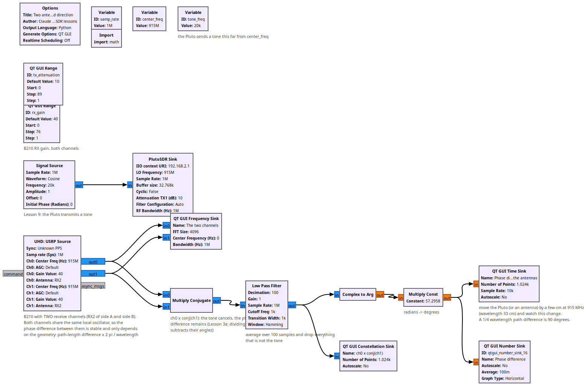
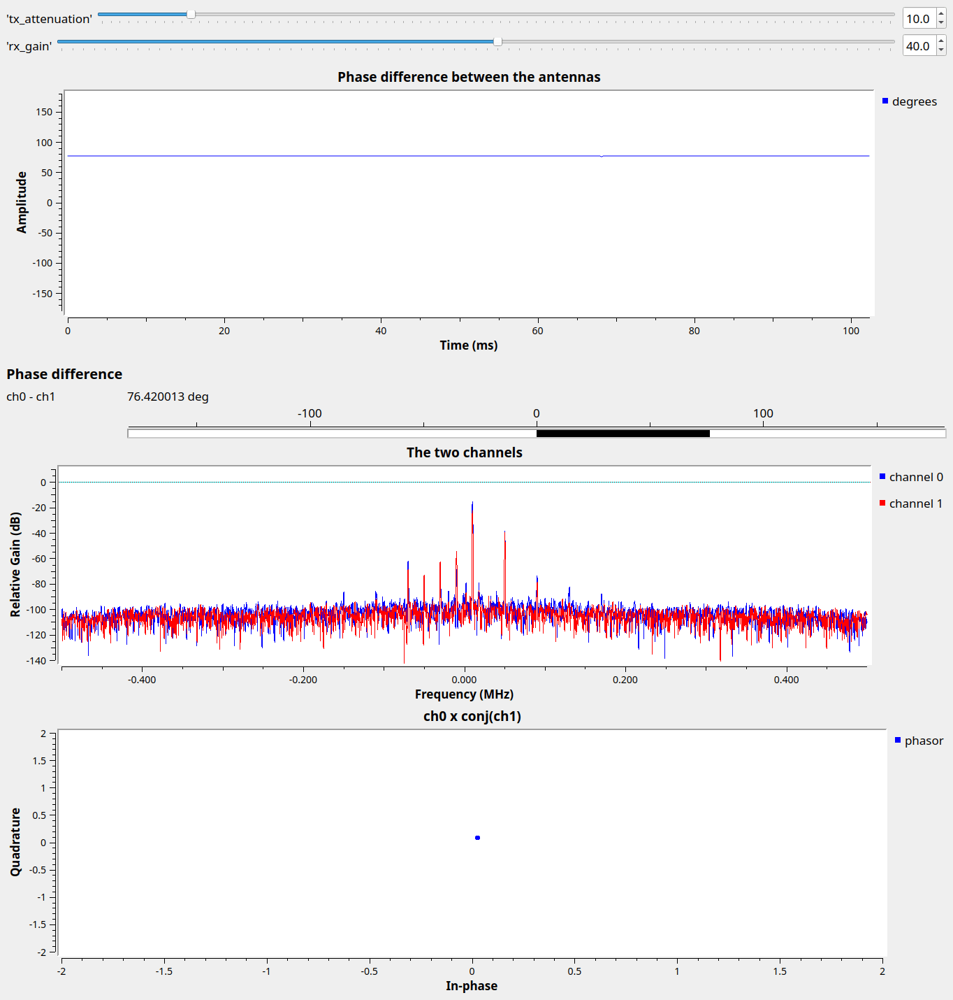

# Lesson 33 --- Two antennas, one clock: phase difference and direction

> **No video for this lesson.** Lessons 24--33 were drafted in October 2026 with the help of an AI assistant (Claude) in the spirit of the lessons above, and tested on the same RTL-SDR / PlutoSDR / B210 setup. They are less polished than the video lessons; corrections and pull requests are welcome.

A USRP B210 has two receivers that share one local oscillator and one sample clock. Tune both to the same frequency and the only difference between what they see is the geometry: a wave arriving from an angle $$\theta$$ off broadside reaches the second antenna a distance $$d\sin\theta$$ later, which at wavelength $$\lambda$$ is a phase difference of $$2\pi d \sin\theta/\lambda$$. Measure the phase difference and you know the direction. Two antennas give one angle; many give a map --- that is an interferometer (see the radio-interferometry slides in this repository) or, run backwards, a phased-array transmitter.

The flowgraph has the Pluto transmit a tone (Lesson 9) and the **UHD: USRP Source** with two channels receive it. The phase difference is extracted the way Lesson 3a taught: multiply channel 0 by the conjugate of channel 1 --- the tone cancels, its phase difference remains --- low-pass filter, and take the angle. At 915 MHz the wavelength is 33 cm, so moving the Pluto by 8 cm along the line of the antennas changes the phase by 90°.

The phase difference also contains a fixed offset from cable lengths and the B210's own paths; real direction finders calibrate it out with a source at a known direction.

## Things to try

- Put the two antennas half a wavelength (16 cm) apart and walk the Pluto around them in a circle. Can you plot angle against phase?
- Swap the antennas' cables: the phase changes sign.
- Why does the phase become meaningless when the antennas are more than $$\lambda/2$$ apart? (The same aliasing as Lesson 6, in space instead of time.)
- The B210's two channels can also *transmit* coherently: beam forming.

<!-- flowgraphs:begin -->
## Flowgraphs

[`lesson33_B210_Two_Antenna_Phase.grc`](https://github.com/gallicchio/learnSDR/blob/main/lesson33_B210_Two_Antenna_Phase.grc)

{:target="_blank"}

Running: both B210 channels see the Pluto tone; their phase difference is steady at about 76 degrees on this bench:

{:target="_blank"}
<!-- flowgraphs:end -->

All GNURadio flowgraphs are at [https://github.com/gallicchio/learnSDR](https://github.com/gallicchio/learnSDR)
