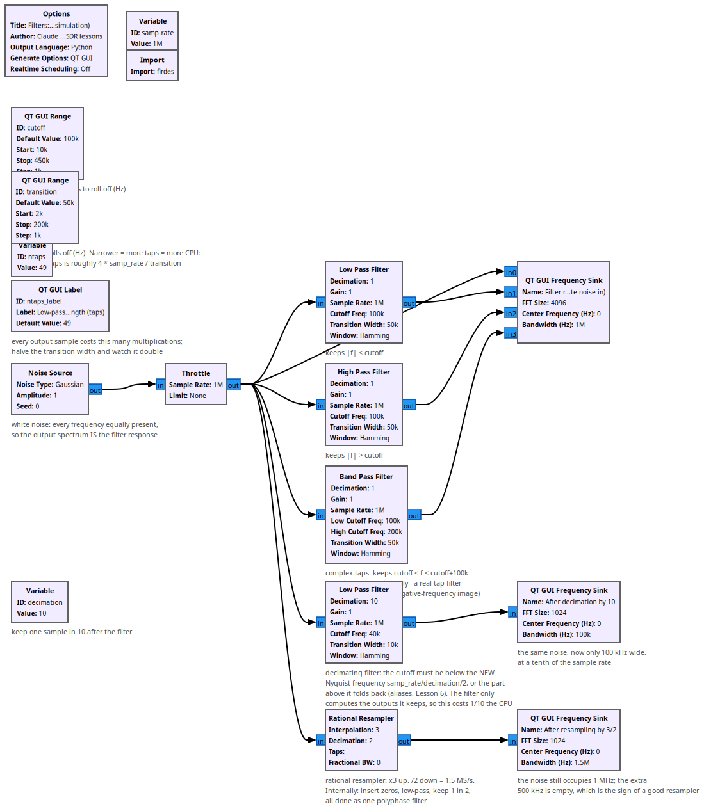
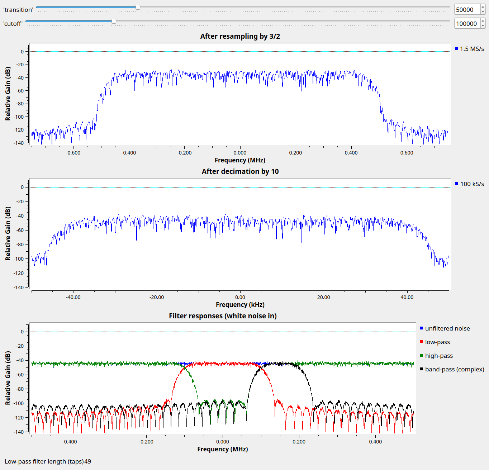

# Lesson 34 --- Filters: low-pass, high-pass, band-pass, transition width and decimation (simulation)

> **No video for this lesson.** Lessons 24--38 were drafted in October 2026 with the help of an AI assistant (Claude) in the spirit of the lessons above, and tested on the same RTL-SDR / PlutoSDR / B210 setup. They are less polished than the video lessons; corrections and pull requests are welcome.

Every lesson has used a **Low Pass Filter** block; this one looks at what the filter parameters mean. White noise (equal power at every frequency) goes in, so the output spectrum *is* the filter's frequency response.

- **Cutoff** is where the filter starts to roll off; **transition width** is how far it takes to get from passing to blocking. A sharper transition needs a longer filter: the number of taps is roughly $$4 f_s/\Delta f$$ (with the Hamming window), and every output sample costs one multiplication per tap. Halve the transition width and watch the tap count double; set it to 2 kHz and watch the CPU meter.
- A **high-pass** filter is the same thing upside down. A **band-pass** filter with *real* taps keeps both $$+f$$ and $$-f$$; with *complex* taps (used here) it can keep positive frequencies only --- the difference between a real and a complex signal again (Lesson 3b).
- **Decimation**: after a low-pass filter you can throw samples away. The cutoff must be below the *new* Nyquist frequency ($$f_s/2D$$), otherwise what is above it folds back in (Lesson 6). The decimating filter only computes the outputs it keeps, so a decimate-by-10 filter costs a tenth of the CPU. This is why Lesson 1 filters *then* decimates before the FM demodulator.
- The **Rational Resampler** changes the rate by 3/2: insert zeros, low-pass, keep one in two, done as a single polyphase filter (the same trick as Lesson 18's filter bank).

## Things to try

- Set the transition width to 2 kHz and the FFT size large: how many taps, and how does the filter edge look?
- Rectangular vs. Blackman window at the same width: compare the stop-band ripple.
- Raise the decimating filter's cutoff above 50 kHz and watch the aliasing.

<!-- flowgraphs:begin -->
## Flowgraphs

[`lesson34_Filters.grc`](https://github.com/gallicchio/learnSDR/blob/main/lesson34_Filters.grc)

{:target="_blank"}

Running: low-, high- and band-pass responses measured with white noise, the decimated and the resampled spectra:

{:target="_blank"}
<!-- flowgraphs:end -->

All GNURadio flowgraphs are at [https://github.com/gallicchio/learnSDR](https://github.com/gallicchio/learnSDR)
