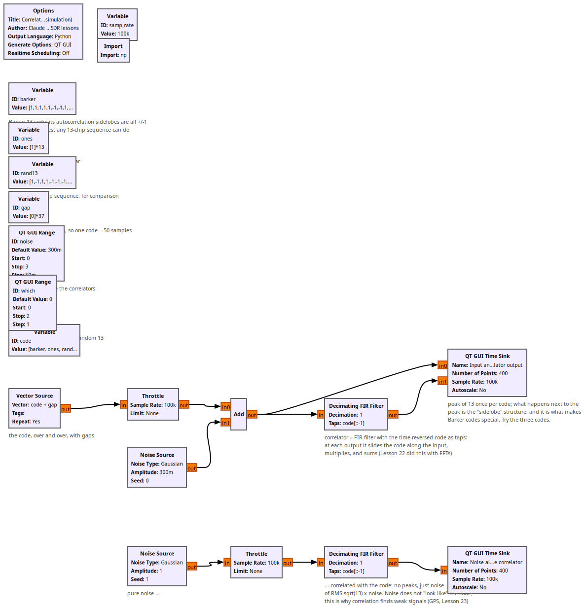
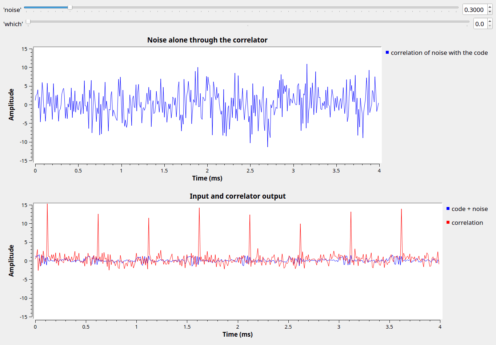

# Lesson 35 --- Correlation: slide, multiply, sum (simulation)

> **No video for this lesson.** Lessons 24--38 were drafted in October 2026 with the help of an AI assistant (Claude) in the spirit of the lessons above, and tested on the same RTL-SDR / PlutoSDR / B210 setup. They are less polished than the video lessons; corrections and pull requests are welcome.

Correlation is the tool under Lessons 22 (GPS codes), 23 (finding satellites 20 dB below the noise), and 29 (finding packets). It answers "where in this stream does something that looks like *my code* occur?" by sliding the code along the stream, multiplying point by point and summing. An **FIR filter whose taps are the time-reversed code** does exactly that at every sample; Lesson 22 did the same with FFTs, which is faster for long codes.

The flowgraph sends a 13-chip code with gaps, adds noise, and correlates. Three codes to compare with the `which` slider:

- **Barker-13**: peak 13 and sidelobes of ±1 everywhere else --- the best any 13-chip binary sequence can do. That is why radars and Wi-Fi's preamble use it.
- **13 ones**: the peak is a triangle 25 samples wide; you cannot tell *where* the code starts to better than several chips.
- **a random 13-chip sequence**: in between.

The second plot sends pure noise through the correlator: no peaks, just noise with RMS $$\sqrt{13}$$ times the input. Noise does not look like the code. The peak grows like $$N$$ and the noise like $$\sqrt{N}$$, so a longer code buys $$\sqrt{N}$$ in signal-to-noise ratio: GPS's 1023 chips give 30 dB.

## Things to try

- Raise `noise` to 2: the code is invisible in the input but still obvious at the correlator output.
- Replace the code by `barker + barker` (26 chips): twice the peak, and what happens to the sidelobes?

<!-- flowgraphs:begin -->
## Flowgraphs

[`lesson35_Correlation.grc`](https://github.com/gallicchio/learnSDR/blob/main/lesson35_Correlation.grc)

{:target="_blank"}

Running with the Barker code: a peak of 13 at every code, +/-1 sidelobes; pure noise gives no peaks:

{:target="_blank"}
<!-- flowgraphs:end -->

All GNURadio flowgraphs are at [https://github.com/gallicchio/learnSDR](https://github.com/gallicchio/learnSDR)
