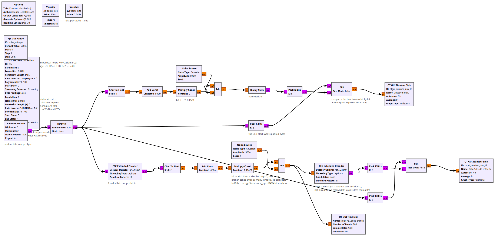
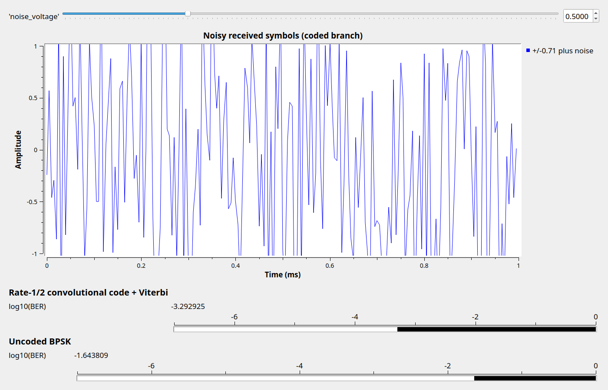

# Lesson 36 --- Error-correcting codes: a convolutional code and the Viterbi decoder (simulation)

> **No video for this lesson.** Lessons 24--38 were drafted in October 2026 with the help of an AI assistant (Claude) in the spirit of the lessons above, and tested on the same RTL-SDR / PlutoSDR / B210 setup. They are less polished than the video lessons; corrections and pull requests are welcome.

Every link in these lessons sent raw bits. Real links add **redundancy** so the receiver can correct errors: the sender transmits more bits than the data contains, chosen so that only certain patterns are valid, and the receiver picks the valid pattern nearest to what it received.

The flowgraph compares two branches at the **same energy per data bit**:

- **Uncoded**: bits → ±1 → noise → hard decision. The bit error rate of BPSK is $$Q(\sqrt{2E_b/N_0})$$: 2.3 % at $$E_b/N_0 = 3$$ dB.
- **Coded**: the **FEC Extended Encoder** with a rate-1/2, constraint-length-7 **convolutional code** (the "K = 7" code of Voyager, Wi-Fi and LTE: every input bit produces two output bits that depend on it and the six before it). Twice as many symbols are sent, so each gets half the energy (the $$1/\sqrt{2}$$ scaling). The **FEC Extended Decoder** runs the **Viterbi algorithm**: it finds, among all possible bit sequences, the one whose encoding is closest to what was received. It takes the noisy values themselves ("soft decisions"), not sliced bits: a received 0.1 counts less than a 0.9.

The **BER** blocks compare each branch with the original bits and show $$\log_{10}$$ of the error rate. With `noise_voltage` = 0.5 ($$E_b/N_0$$ = 3 dB) the code turns 2.3 % errors into 0.04 %, about 4 dB of **coding gain**. DVB-S2 (Lesson 38) and 5G use LDPC codes that get within a fraction of a dB of the Shannon limit.

## Things to try

- Sweep the noise: at very high noise the coded branch is *worse* than uncoded (the decoder is fooled); at low noise it is spectacularly better. Where do the curves cross?
- Change the decoder to take hard decisions (add a Binary Slicer before it and a Char to Float after): about 2 dB is lost.
- Rate 1/2 with a 7-bit memory is small; LTE uses a turbo code with 2 blocks, DVB-S2 LDPC codes 64800 bits long.

<!-- flowgraphs:begin -->
## Flowgraphs

[`lesson36_Error_Correction.grc`](https://github.com/gallicchio/learnSDR/blob/main/lesson36_Error_Correction.grc)

{:target="_blank"}

Running at Eb/N0 = 3 dB: uncoded BPSK 2.3 % bit errors, the rate-1/2 code with Viterbi decoding 0.04 %:

{:target="_blank"}
<!-- flowgraphs:end -->

All GNURadio flowgraphs are at [https://github.com/gallicchio/learnSDR](https://github.com/gallicchio/learnSDR)
