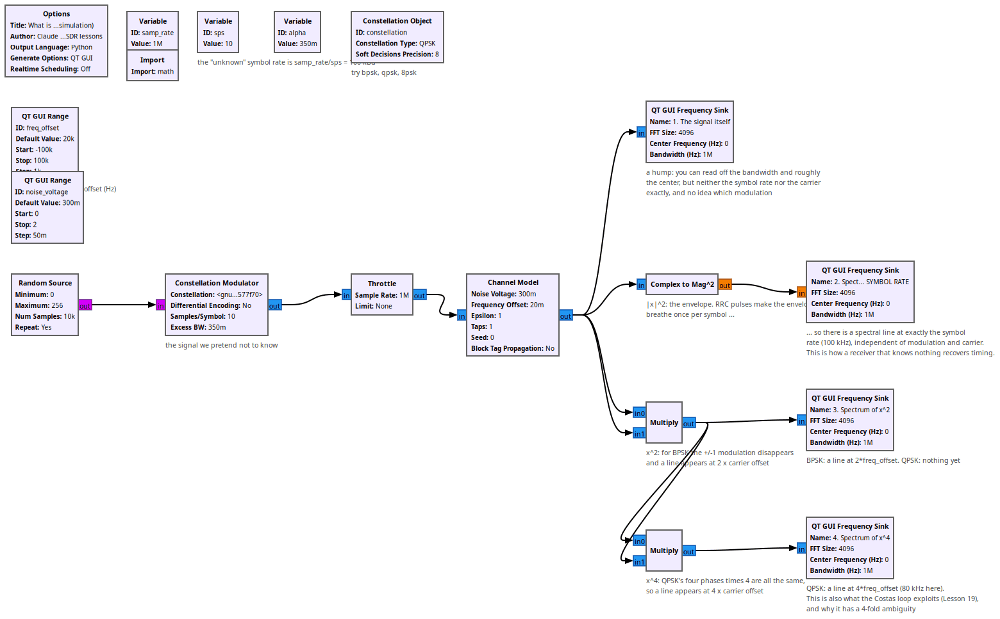
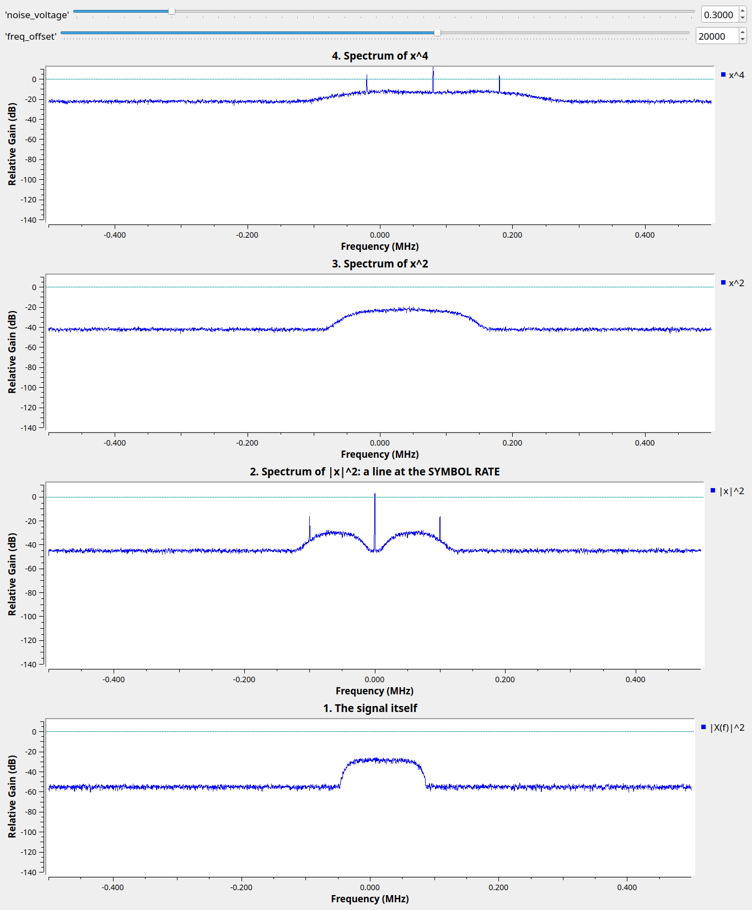

# Lesson 37 --- What is that signal? Symbol rate and carrier from nonlinearities (simulation)

> **No video for this lesson.** Lessons 24--38 were drafted in October 2026 with the help of an AI assistant (Claude) in the spirit of the lessons above, and tested on the same RTL-SDR / PlutoSDR / B210 setup. They are less polished than the video lessons; corrections and pull requests are welcome.

Suppose you find an unknown digital signal (Lesson 1e). Its spectrum tells you its bandwidth and roughly its center, but not the symbol rate, not the exact carrier, and not the modulation. Squaring and other nonlinearities do, because they turn hidden periodicities into spectral lines:

1. **|x|²** (the envelope power): root-raised-cosine pulses make the envelope breathe once per symbol, so the spectrum of |x|² has a sharp line at exactly the **symbol rate**, whatever the modulation and carrier. Timing recovery (Lesson 18) is built on this.
2. **x²**: for BPSK the ±1 modulation disappears and a line appears at **twice the carrier offset**. For QPSK nothing happens yet.
3. **x⁴**: QPSK's four phases times four coincide, so a line appears at **four times the carrier offset**. This is what the Costas loop (Lesson 19) exploits, and why it has a four-fold ambiguity (Lesson 20). 8PSK needs x⁸.

So: a line in x² but not in |x|² means a carrier, a line in x⁴ only means QPSK, lines only in |x|² means something with constant envelope (FSK, GMSK; Lesson 25).

## Things to try

- Switch the constellation to BPSK and to 8PSK and see which plot gets the line.
- Lower `alpha` toward 0: the symbol-rate line in |x|² weakens (a brick-wall pulse has no envelope ripple). Raise the noise: which line survives longest?
- Lesson 16's over-the-air BPSK through these three plots: replace the Constellation Modulator by the RTL-SDR Source.

<!-- flowgraphs:begin -->
## Flowgraphs

[`lesson37_Signal_Identification.grc`](https://github.com/gallicchio/learnSDR/blob/main/lesson37_Signal_Identification.grc)

{:target="_blank"}

Running with QPSK, 100 kBd, 20 kHz carrier offset: the symbol-rate line in |x|^2 and the 4 x offset line in x^4:

{:target="_blank"}
<!-- flowgraphs:end -->

All GNURadio flowgraphs are at [https://github.com/gallicchio/learnSDR](https://github.com/gallicchio/learnSDR)
