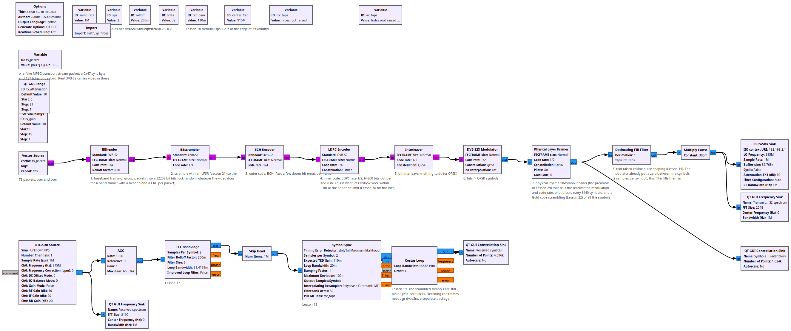
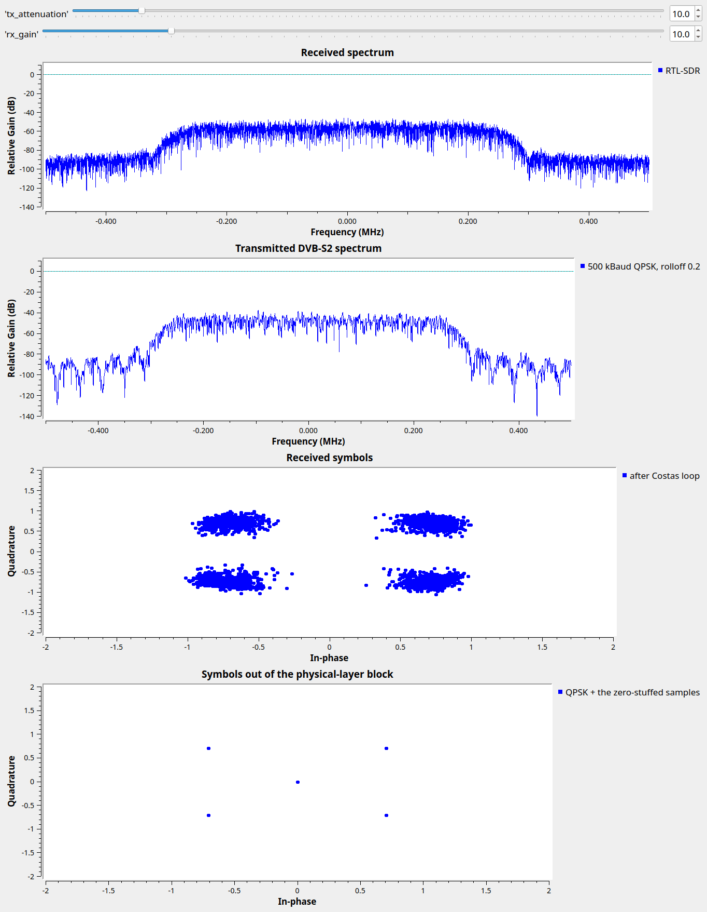

# Lesson 38 --- A real standard: DVB-S2, the satellite-TV waveform, from Pluto to RTL-SDR

> **No video for this lesson.** Lessons 24--38 were drafted in October 2026 with the help of an AI assistant (Claude) in the spirit of the lessons above, and tested on the same RTL-SDR / PlutoSDR / B210 setup. They are less polished than the video lessons; corrections and pull requests are welcome.

Everything in Lessons 12--36 is in a modern standard, usually all at once. DVB-S2 (digital satellite television, also used for data links) is a good example because GNU Radio ships its complete transmitter. The flowgraph sends fake MPEG transport-stream packets through it:

1. **BBHeader**: packets are grouped into a baseband frame with a header.
2. **BBScrambler**: an LFSR (Lesson 21) scrambles the bits so they look random.
3. **BCH** encoder: an outer code that cleans up the last few errors.
4. **LDPC** encoder: the inner rate-1/2 code, 64800 bits per frame --- the reason DVB-S2 works within a dB of the Shannon limit (Lesson 36 for the idea).
5. **Interleaver** and 6. **Modulator**: bits to QPSK symbols (8PSK, 16APSK and 32APSK are available).
7. **Physical layer**: a 90-symbol header that tells the receiver the modulation and code rate (Lesson 29's preamble), pilot blocks every 1440 symbols, and Gold-code scrambling of all symbols (Lesson 22).
8. **Root-raised-cosine** pulse shaping with roll-off 0.2 (Lesson 15), at 500 ksymbol/s here.

The receiver side is our own chain from Lessons 17--19 (AGC, FLL, Symbol Sync, Costas loop). Because the scrambling only rotates symbols by multiples of 90°, the result is a clean QPSK constellation. (The GNU Radio modulator emits its symbols with a zero sample between them, i.e. already at 2 samples per symbol, which is why the pulse-shaping filter is an ordinary FIR filter rather than an interpolating one: filtering fills in the zeros, Lesson 6.) Decoding the frames themselves needs the `gr-dvbs2rx` out-of-tree module; with it, or with any satellite-TV receiver chip, this signal is a valid DVB-S2 transmission.

## Things to try

- Switch the modulator and physical-layer blocks to 8PSK (the LDPC block's constellation must match).
- Change the code rate to 9/10 and watch nothing visible change: the symbol stream looks the same, only its robustness differs.
- Receive a real satellite: a DVB-S2 LNB and dish on the RTL-SDR, and `gr-dvbs2rx`.

<!-- flowgraphs:begin -->
## Flowgraphs

[`lesson38_DVBS2_Pluto_to_RTL.grc`](https://github.com/gallicchio/learnSDR/blob/main/lesson38_DVBS2_Pluto_to_RTL.grc)

{:target="_blank"}

Running over the air: the DVB-S2 spectrum at the RTL-SDR and the QPSK constellation after our Lesson 17-19 receiver:

{:target="_blank"}
<!-- flowgraphs:end -->

All GNURadio flowgraphs are at [https://github.com/gallicchio/learnSDR](https://github.com/gallicchio/learnSDR)
